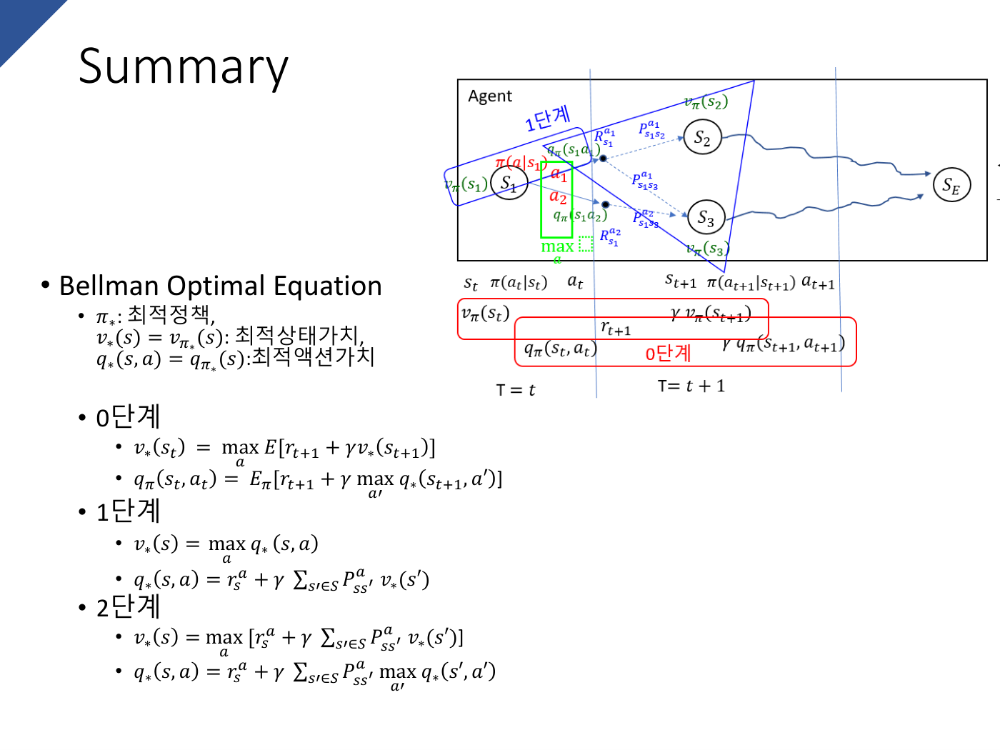
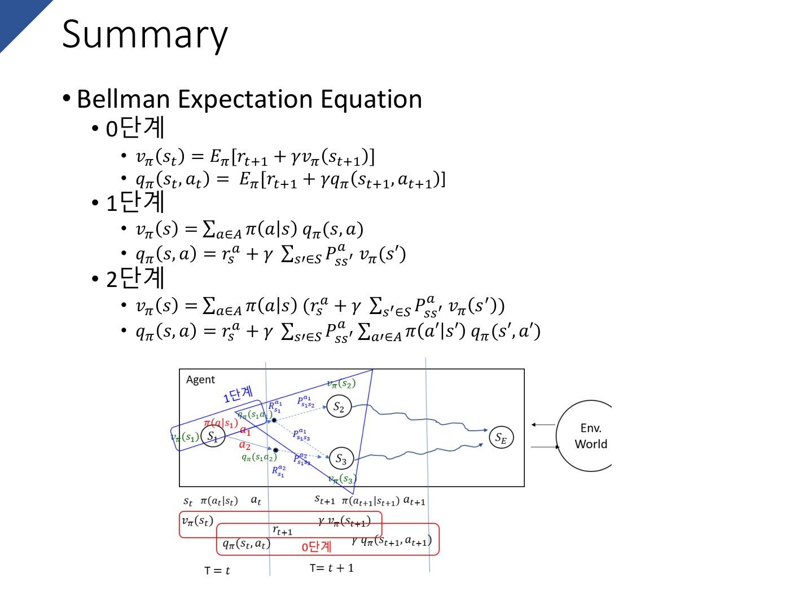

# Bellman Equation

원본 [10-03-Bellman Exquation V06.pdf](https://drive.google.com/file/d/1QjGAcEmGKPsMF1GSpOtjMVN94ImM4rTH/view?usp=drivesdk)

## Bellman Expectation Equation

강의 8`16, 28쪽은 Return의 재귀 구조 $G_t=R_{t+1}+\gamma G_{t+1}$에서 시작해 현재 가치와 다음 가치의 관계를 세 단계로 쓴다.

**0단계**. 고정된 정책 $\pi$에서 다음 보상과 다음 가치의 기댓값을 취한다.

$$
v_\pi(s_t)=E_\pi[r_{t+1}+\gamma v_\pi(s_{t+1})],\qquad
q_\pi(s_t,a_t)=E_\pi[r_{t+1}+\gamma q_\pi(s_{t+1},a_{t+1})].
$$

**1단계**. 첫 식은 현재 행동에 대한 정책 평균, 둘째 식은 다음 상태에 대한 모델 평균이다.

$$
v_\pi(s)=\sum_{a\in A}\pi(a\mid s)q_\pi(s,a),\qquad
q_\pi(s,a)=r_s^a+\gamma\sum_{s'\in S}P_{ss'}^a v_\pi(s').
$$

**2단계**. 한 가치식을 다른 가치식에 대입해 $v$만 또는 $q$만 남긴다.

$$
\begin{aligned}
v_\pi(s)&=\sum_{a\in A}\pi(a\mid s)
\left(r_s^a+\gamma\sum_{s'\in S}P_{ss'}^a v_\pi(s')\right),\\
q_\pi(s,a)&=r_s^a+\gamma\sum_{s'\in S}P_{ss'}^a
\sum_{a'\in A}\pi(a'\mid s')q_\pi(s',a').
\end{aligned}
$$

$r_s^a$는 현재 상태·행동에서의 기대 즉시 보상이고, $P_{ss'}^a$는 다음 상태 확률이다. 예를 들어 $r_s^a=1$, $\gamma=0.9$, 다음 상태가 확률 $0.75,0.25$로 각각 가치 $4,0$에 도달하면 $q_\pi(s,a)=1+0.9(0.75\cdot4+0.25\cdot0)=3.7$이다.

## Bellman Optimal Equation

강의 23`29쪽에서 $\pi_*$를 최적 정책으로 두고 $v_*(s)=\max_a q_*(s,a)$, $q_*(s,a)=r_s^a+\gamma\sum_{s'\in S}P_{ss'}^a v_*(s')$로 연결한다. 대입 결과는 다음과 같다.

$$
\begin{aligned}
v_*(s)&=\max_a\left[r_s^a+\gamma\sum_{s'\in S}P_{ss'}^a v_*(s')\right],\\
q_*(s,a)&=r_s^a+\gamma\sum_{s'\in S}P_{ss'}^a\max_{a'}q_*(s',a').
\end{aligned}
$$

$v_*$에서는 지금 행동을 정한 뒤 가능한 다음 상태의 평균을 취한다. $q_*$에서는 현재 행동이 이미 정해져 있고, 각각 도달한 $s'$에서 그 상태에 맞는 최선의 $a'$를 고른다. 지금 가능한 행동의 $q$가 $3.7$과 $2.9$라면 균일 정책의 상태가치는 $3.3$이고, 이 둘이 최적 미래를 반영하는 $q_*$라면 최적 상태가치는 $3.7$이다.

원본 29쪽의 0단계 $q$식은 좌변을 $q_\pi$로 적지만 우변에 $\max_{a'}q_*$를 사용한다. 문맥상 그 식의 좌변은 최적 Action-Value $q_*(s_t,a_t)$다. 위의 2단계 식은 원본 27`29쪽의 별표 아래첨자 관례를 따른다.

## Original Slides

아래 도판에는 원본의 수식·기호·첨자와 강의 예시를 그대로 담았다. 본문의 유도식과 손계산은 개념을 이해하기 위한 해설이다.

### PDF p. 28

### PDF p. 29

