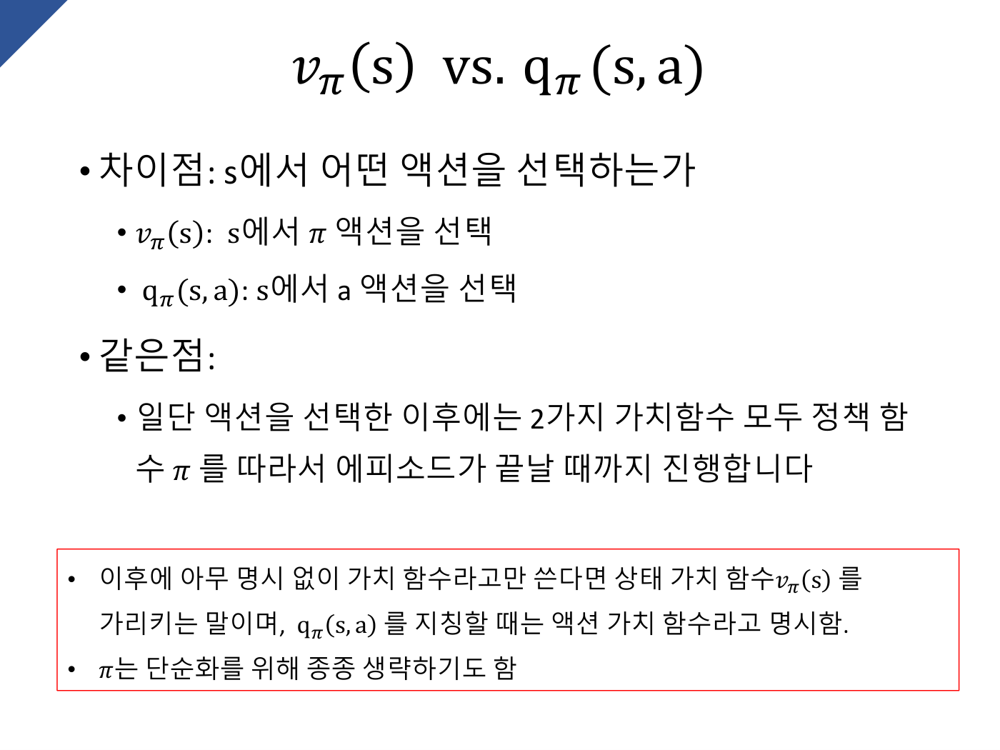
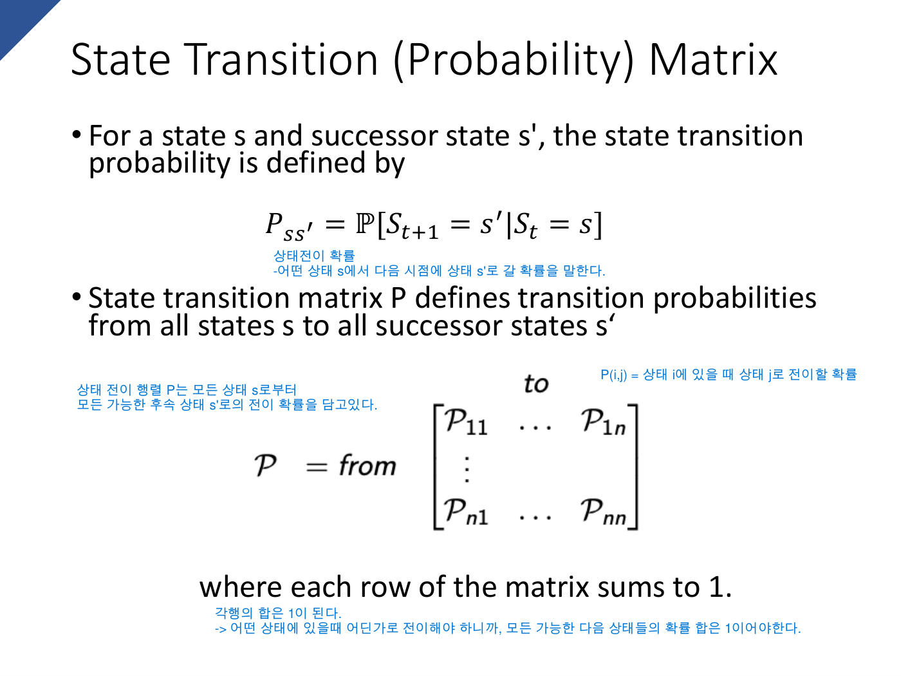
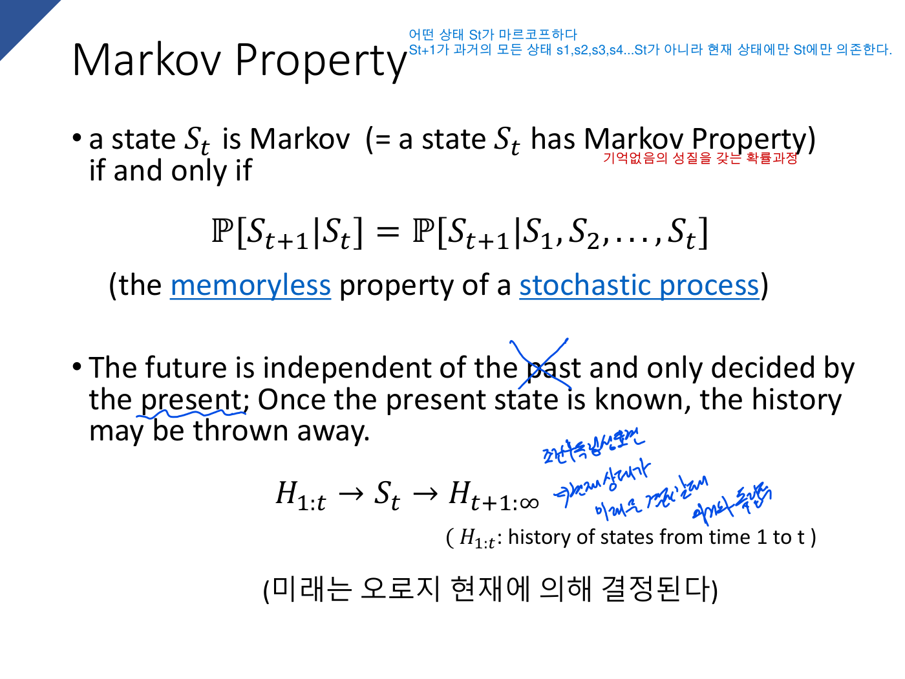
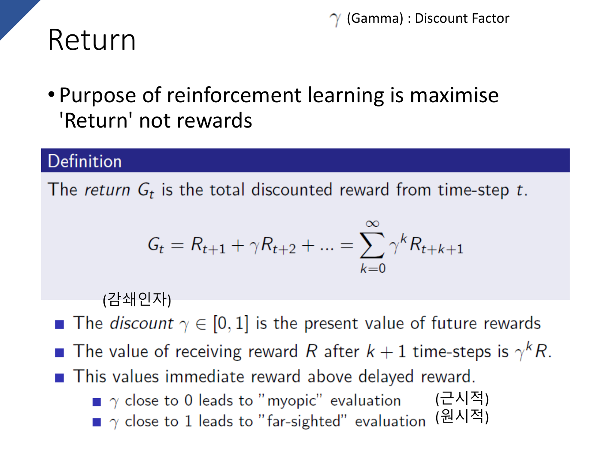
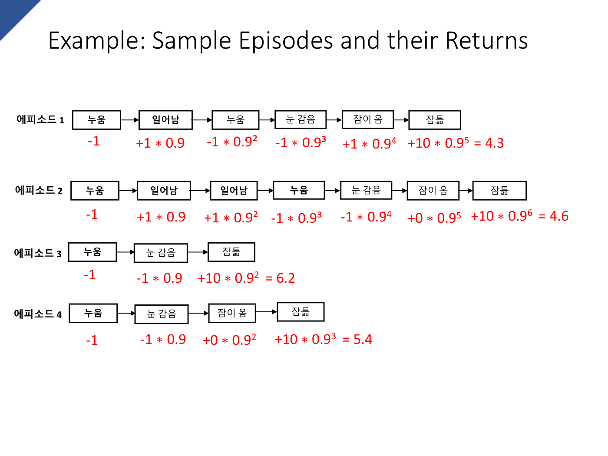
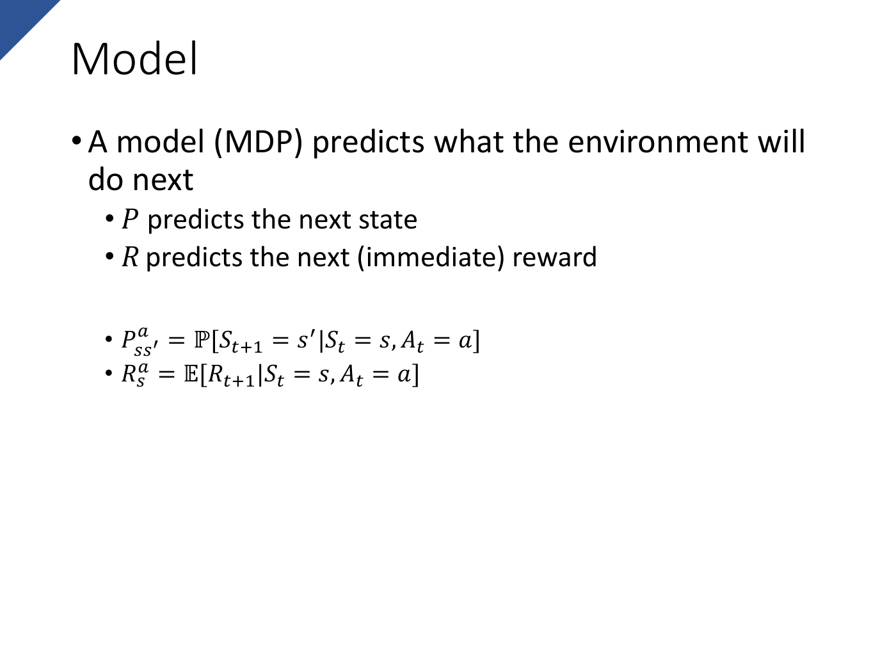
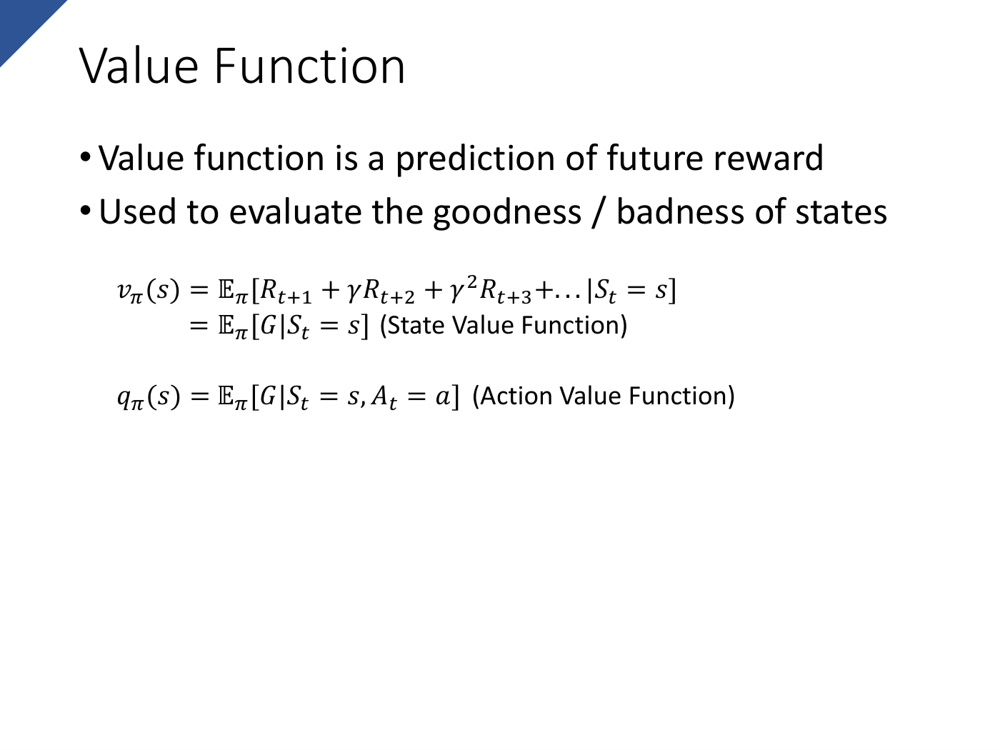

# Markov Decision Process

원본 [09-02-MDP(Markov Decision Process) V05.pdf](https://drive.google.com/file/d/1UeYs9pIcZUb0DSzqHPUXCB9TxiMdJgp5/view?usp=drivesdk)

## Stochastic Process → Markov Process → Markov Reward Process → MDP

| 구성 | 강의 표기 | 의미 |
|---|---|---|
| Markov Process | $\langle S,P\rangle$ | 상태와 상태 간 전이 확률 |
| Markov Reward Process | $\langle S,P,R,\gamma\rangle$ | 전이에 따른 보상과 할인율을 더한 과정 |
| Markov Decision Process | $\langle S,A,P,R,\gamma\rangle$ | 행동 선택에 따라 전이와 보상이 달라지는 모형 |

원본 9`12쪽에서 $P_{ss'}=\mathbb{P}[S_{t+1}=s'\mid S_t=s]$다. 전이행렬의 행 $s$에서 열 $s'$의 값은 다음에 $s'$로 갈 확률이고 각 행의 합은 1이다. Markov Property는 $\mathbb P[S_{t+1}\mid S_t]=\mathbb P[S_{t+1}\mid S_1,\ldots,S_t]$로 표현한다. 현재 상태를 알면 과거를 더 알아도 다음 상태의 조건부 분포가 달라지지 않는다는 뜻이다. 원본 25쪽의 $S_t=f(H_t)$는 관측·행동·보상의 이력에서 의사결정에 사용할 상태를 정의한다는 의미다.

MDP의 $P_{ss'}^a=\mathbb P[S_{t+1}=s'\mid S_t=s,A_t=a]$, $R_s^a=\mathbb E[R_{t+1}\mid S_t=s,A_t=a]$에서 위첨자 $a$는 행동이다. 같은 위치에서도 왼쪽 이동과 오른쪽 이동은 다음 상태의 분포를 다르게 만든다.

## Return, Value Function, Policy

$$
G_t=\sum_{k=0}^{\infty}\gamma^kR_{t+k+1},\qquad
v_\pi(s)=\mathbb E_\pi[G_t\mid S_t=s].
$$

$\gamma$는 미래 보상의 가중치다. 원본 20쪽의 세 번째 에피소드에 $\gamma=0.9$를 적용하면 $-1-1\cdot0.9+10\cdot0.9^2=6.2$다. 첫 보상의 지수가 0인 이유는 현재 행동 직후 얻는 보상이기 때문이다.

- **State-Value Function** $v_\pi(s)$는 지금부터 $\pi$를 따를 때의 기대 Return이다.
- **Action-Value Function** $q_\pi(s,a)$는 첫 행동을 $a$로 고정하고 이후에 $\pi$를 따를 때의 기대 Return이다. 원본 30쪽은 좌변을 $q_\pi(s)$로 적고 우변에는 $A_t=a$를 조건으로 명시한다.
- **Deterministic Policy**는 $\pi(s)=a$, **Stochastic Policy**는 $\pi(a\mid s)=\mathbb P[A_t=a\mid S_t=s]$다.

## Grid World에 적용

1. 격자 위치를 $s$, 상하좌우를 $a$로 정의한다.
2. 격자 밖 이동, 장애물, 목표 도달을 포함해 각 $(s,a)$의 전이와 보상을 정한다.
3. 균일 무작위 Policy를 쓰면 각 방향을 0.25로 선택한다. 이동이 결정적이면 선택한 행동의 환경 전이 확률은 1이다. 두 확률은 의미가 다르다.
4. 주어진 Policy의 $v_\pi$를 구하면 **Prediction**, 최대 Return을 주는 $\pi_*$를 찾으면 **Control**이다(35`38쪽).

## Original Slides

아래 도판에는 원본의 수식·기호·첨자와 강의 예시를 그대로 담았다. 본문의 유도식과 손계산은 개념을 이해하기 위한 해설이다.

### PDF p. 9

### PDF p. 11

### PDF p. 18

### PDF p. 20

### PDF p. 29

### PDF p. 30

### PDF p. 32

