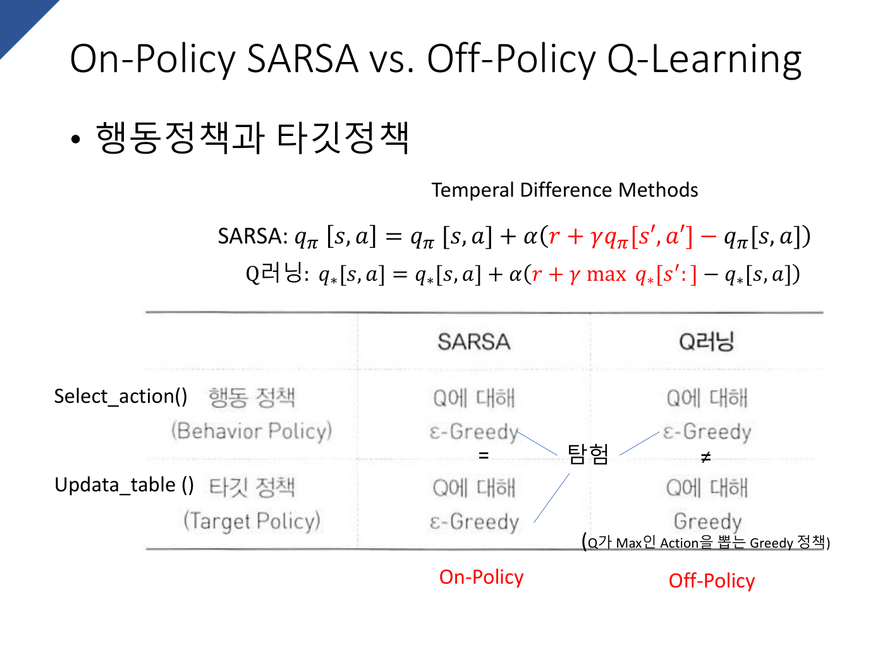
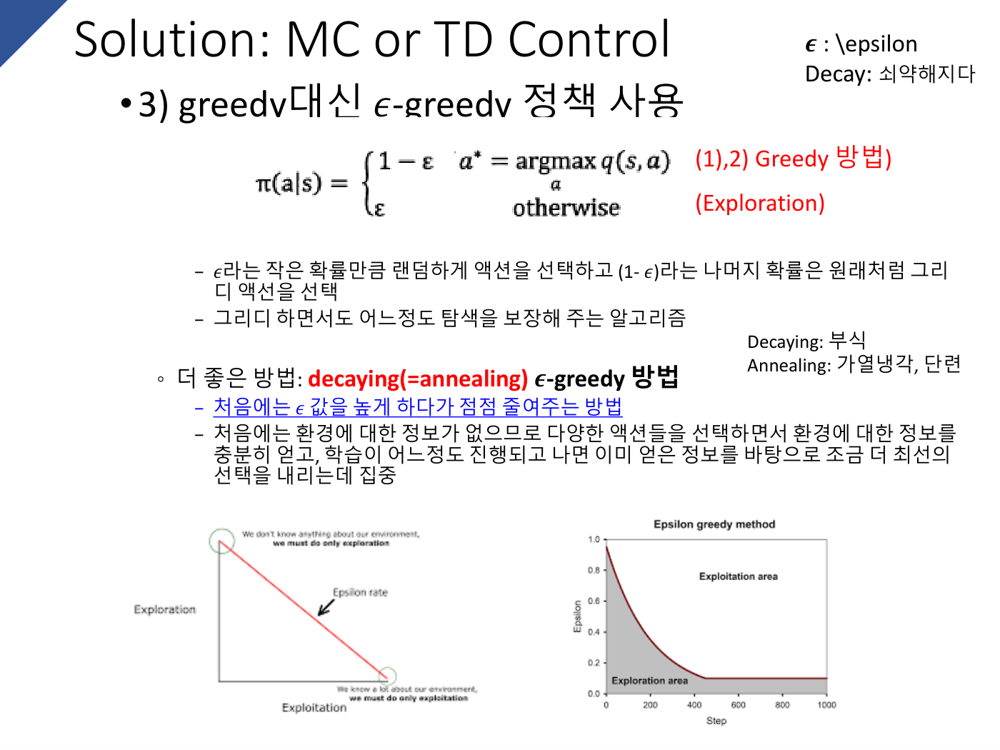
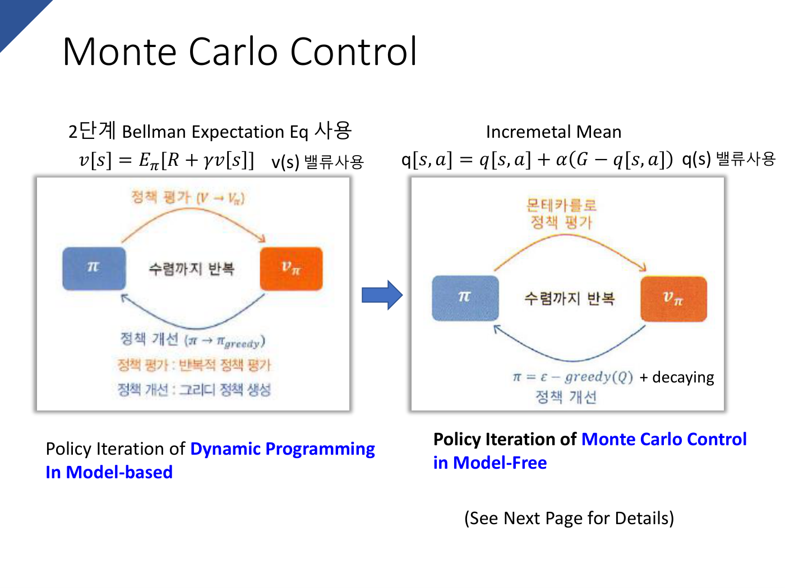

# Model-Free Control

원본 [12-Model-Free Control-V08.pdf](https://drive.google.com/file/d/1cyPNNRkPJJcslYfoDBufLYCNvwseXVIx/view?usp=drivesdk)

## Action-Value와 ε-Greedy

모델을 모르면 $V(s')$만으로 각 행동의 전이 결과를 평가하기 어렵다. $q[s,a]$를 학습하면 현재 상태에서 행동별 기대 Return을 직접 비교할 수 있다. ε-Greedy는 확률 $\epsilon$로 모든 행동에서 균등 추출하고, 확률 $1-\epsilon$로 최대 $q$ 행동을 선택한다. 최대가 하나이고 행동이 $m$개면 Greedy Action의 총확률은 $1-\epsilon+\epsilon/m$, 나머지는 각각 $\epsilon/m$이다. $m=4,\epsilon=0.2$라면 각각 0.85와 0.05다. 강의는 초기에 탐색을 넓게 하고 점차 $\epsilon$을 줄이는 방법을 설명한다(8`11쪽).

## Monte Carlo Control

강의 12`19쪽의 갱신식은 $q[s,a]\leftarrow q[s,a]+\alpha(G-q[s,a])$다. $\epsilon$-Greedy로 에피소드를 생성하고, 종료 뒤 각 방문의 할인 Return을 계산해 해당 $(s,a)$를 갱신한다. 다음 에피소드에서는 새 $q$값에 기반해 행동한다. 강의의 Grid World에서 매 스텝 보상이 $-1$이면, 다른 보상이나 제약이 동일할 때 짧게 목표에 도달하는 경로가 더 높은 Return을 얻는다.

## SARSA · On-Policy

$$
q_\pi[s,a]\leftarrow q_\pi[s,a]+\alpha\left(r+\gamma q_\pi[s',a']-q_\pi[s,a]\right).
$$

1. 상태 $s$에서 ε-Greedy로 $a$를 뽑고 실행한다.
2. $r,s'$를 받은 뒤 종료가 아니면 같은 행동 정책에서 $a'$를 뽑는다.
3. $(s,a,r,s',a')$를 사용해 위 식을 적용한다.
4. $s\leftarrow s'$, $a\leftarrow a'$로 진행한다. 실제 종료에서는 타깃이 $r$이다.

## Q-Learning · Off-Policy

$$
q[s,a]\leftarrow q[s,a]+\alpha\left(r+\gamma\max_{a'}q[s',a']-q[s,a]\right).
$$

환경에서 다음 행동을 탐색적으로 뽑더라도 학습 타깃에는 다음 상태의 최대 $q$를 넣는다. 원본 32쪽의 $q_*[s',:]$는 다음 상태의 모든 행동에 대한 행을 뜻한다. Python의 `np.max(q_table[next_state])`는 그 행의 최대 **값**을 반환하고, 행동 **인덱스**가 필요할 때는 `argmax`를 쓴다(20`41쪽).

### 한 전이의 손계산

$q[s,a]=2$, $r=-1$, $\gamma=0.9$, $\alpha=0.1$이고 $s'$의 행동 값이 $(4,1)$이라고 하자.

| 방법 | Target | 새 $q[s,a]$ |
|---|---:|---:|
| SARSA에서 실제 $a'$의 값이 1 | $-1+0.9(1)=-0.1$ | $2+0.1(-0.1-2)=1.79$ |
| Q-Learning | $-1+0.9(4)=2.6$ | $2+0.1(2.6-2)=2.06$ |

차이가 생기는 곳은 Target이다. SARSA는 실제 다음 탐색 행동의 결과까지 평가에 반영하고, Q-Learning은 행동 데이터에서 Greedy Target을 학습한다.

## Original Slides

아래 도판에는 원본의 수식·기호·첨자와 강의 예시를 그대로 담았다. 본문의 유도식과 손계산은 개념을 이해하기 위한 해설이다.

### PDF p. 11

### PDF p. 12

### PDF p. 32

