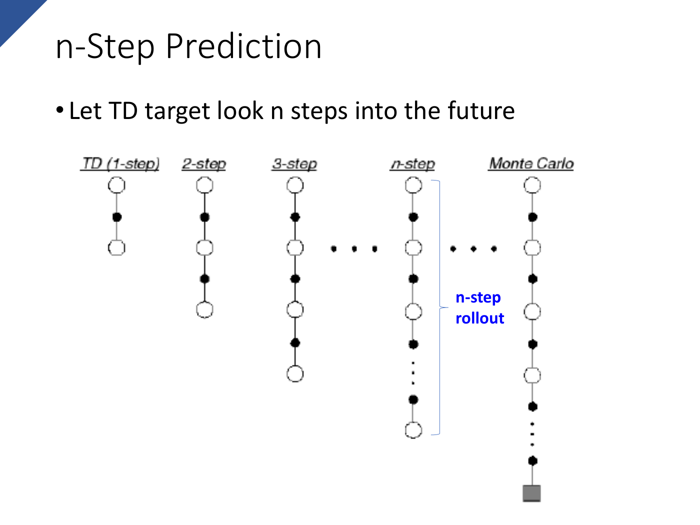
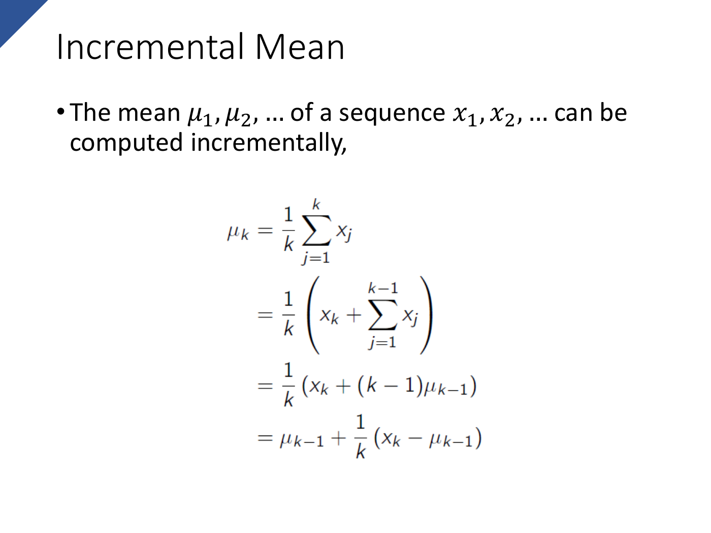
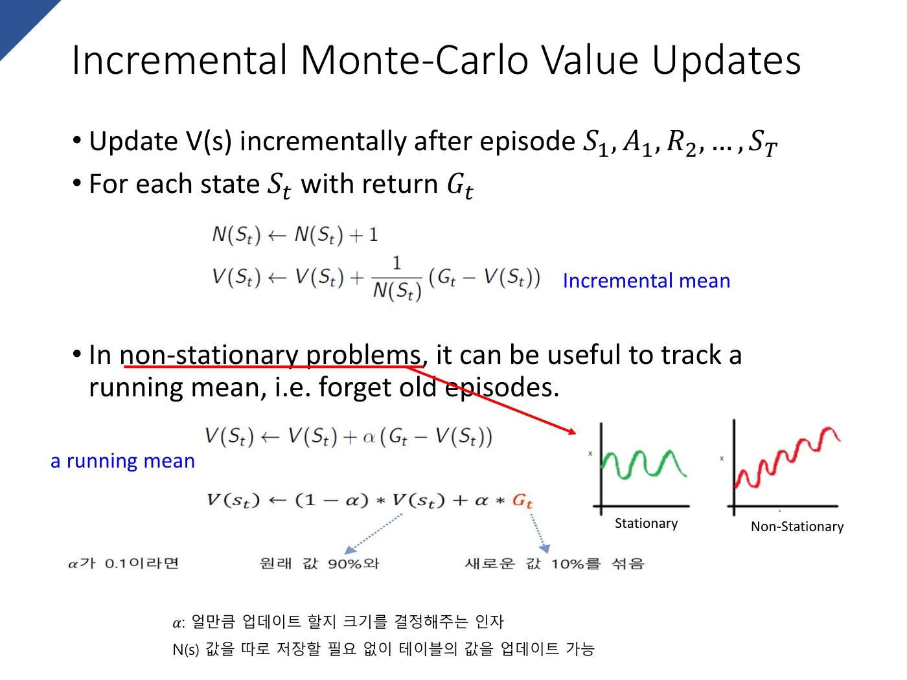
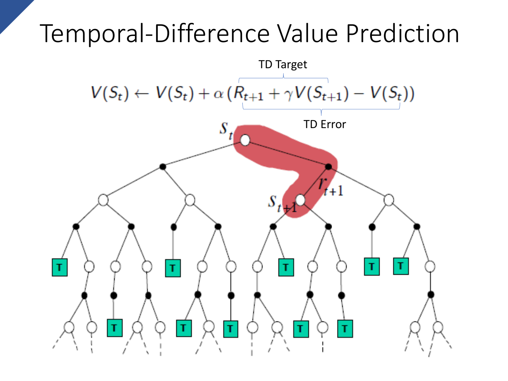
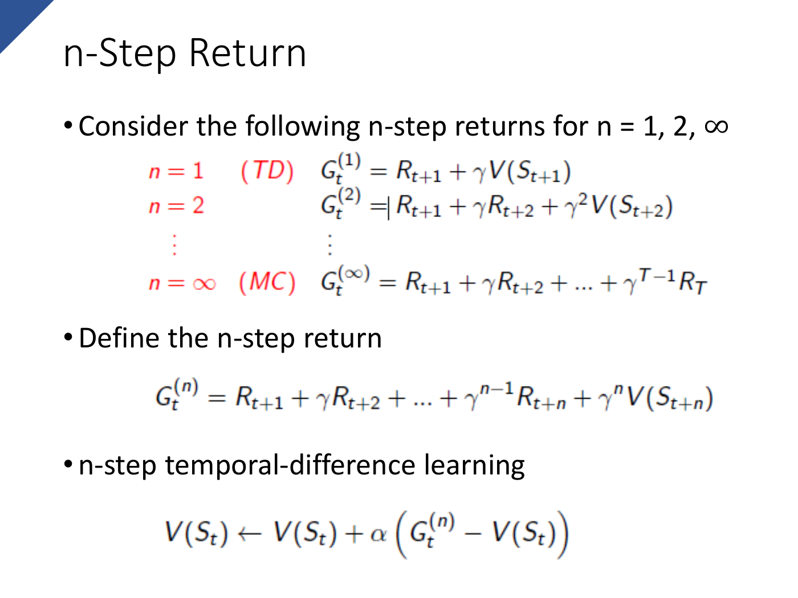

# Model-Free Value Prediction

원본 [11-Model-Free Value Prediction V02 (2).pdf](https://drive.google.com/file/d/1SWmILQly6zywEQPIfmuKa2NAMWj0CHcr/view?usp=drivesdk)

## Monte Carlo Policy Evaluation

환경 모델 없이 정책 $\pi$를 실행해 얻은 에피소드로 $V(s)$를 추정한다. 원본 7`18쪽은 방문 이후의 Return $G_t$를 평균한다. First-Visit MC는 한 에피소드에서 그 상태의 첫 방문만, Every-Visit MC는 모든 방문을 포함한다.

$$
N(S_t)\leftarrow N(S_t)+1,\qquad
V(S_t)\leftarrow V(S_t)+\frac{1}{N(S_t)}(G_t-V(S_t)).
$$

평균의 재귀식 $\mu_k=\mu_{k-1}+\frac1k(x_k-\mu_{k-1})$을 그대로 사용한다. 원본의 고정 Step Size 표기는 $V(S_t)\leftarrow V(S_t)+\alpha(G_t-V(S_t))$다. Return이 4, 8 순서로 도착하면 표본평균은 $4+(8-4)/2=6$이다.

1. 현재 정책을 유지하며 에피소드를 생성한다.
2. 끝에서부터 $G_t=R_{t+1}+\gamma G_{t+1}$로 Return을 계산한다.
3. First-Visit을 쓸 때는 시간상 처음 방문한 인덱스만 갱신한다. 역순으로 계산할 때 단순히 처음 만난 상태를 선택하면 시간상 마지막 방문이 된다.
4. 독립적으로 여러 Run을 반복하면 강의 과제처럼 에피소드 수에 따른 상태가치의 평균과 분산을 비교할 수 있다.

## Temporal-Difference Learning · TD(0)

$$
V(S_t)\leftarrow V(S_t)+\alpha\left(R_{t+1}+\gamma V(S_{t+1})-V(S_t)\right).
$$

$R_{t+1}+\gamma V(S_{t+1})$는 TD Target, 괄호 전체는 TD Error $\delta_t$다. 다음 상태의 추정값을 활용하는 것을 Bootstrapping이라 한다. $V(S_t)=2,V(S_{t+1})=4,R_{t+1}=1,\alpha=0.1,\gamma=0.9$이면 타깃은 4.6, 오차는 2.6, 새 값은 2.26이다. 실제 종료에서는 이후 가치가 0이다. TD(0)는 한 전이 직후 갱신하고, 일반적인 에피소드 MC는 전체 Return이 확보된 뒤 갱신한다(25`47쪽).

## n-Step TD

$$
G_t^{(n)}=R_{t+1}+\gamma R_{t+2}+\cdots+\gamma^{n-1} R_{t+n}
+\gamma^nV(S_{t+n}),
\qquad
V(S_t)\leftarrow V(S_t)+\alpha(G_t^{(n)}-V(S_t)).
$$

1-step은 TD(0)와 같다. $n$ 스텝 전에 종료하면 종료까지 실제 보상만 더한다. 예를 들어 $R_{t+1}=1,R_{t+2}=2,V(S_{t+2})=3,\gamma=0.9$이면 2-step Target은 $1+0.9\cdot2+0.9^2\cdot3=5.23$이다(48`53쪽).

자료 목차의 **TD($\lambda$)**를 읽는 데 필요한 보충으로, 유한 에피소드에서 $n$-step Return들을 섞는 Forward View는 $G_t^\lambda=(1-\lambda)\sum_{n=1}^{T-t-1}\lambda^{n-1}G_t^{(n)}+\lambda^{T-t-1}G_t$이다. $\lambda=0$이면 1-step, $\lambda=1$이면 전체 Return을 쓴다.

| 방법 | 표본 사용 | Bootstrapping |
|---|---|---|
| Dynamic Programming | 모델에서 모든 결과를 확률 가중 평균 | 사용 |
| Monte Carlo | 에피소드의 실현 Return | 사용하지 않음 |
| TD | 관측한 전이 일부 | 사용 |

고정 정책으로 얻은 MC Return은 해당 상태가치의 표본이다. TD는 다음 상태의 현재 추정오차를 타깃에 가져올 수 있는 대신 전체 경로를 기다리지 않아 보통 업데이트 분산이 더 낮다. 문제에 따라 실제 차이는 달라진다.

## Original Slides

아래 도판에는 원본의 수식·기호·첨자와 강의 예시를 그대로 담았다. 본문의 유도식과 손계산은 개념을 이해하기 위한 해설이다.

### PDF p. 17

### PDF p. 18

### PDF p. 28

### PDF p. 49

### PDF p. 51

