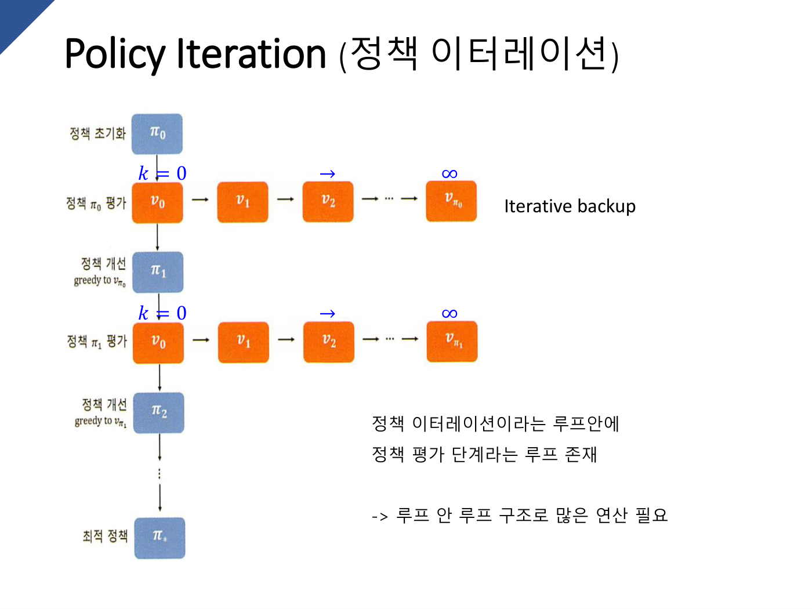
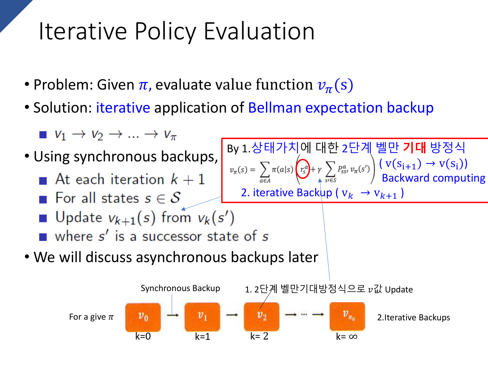
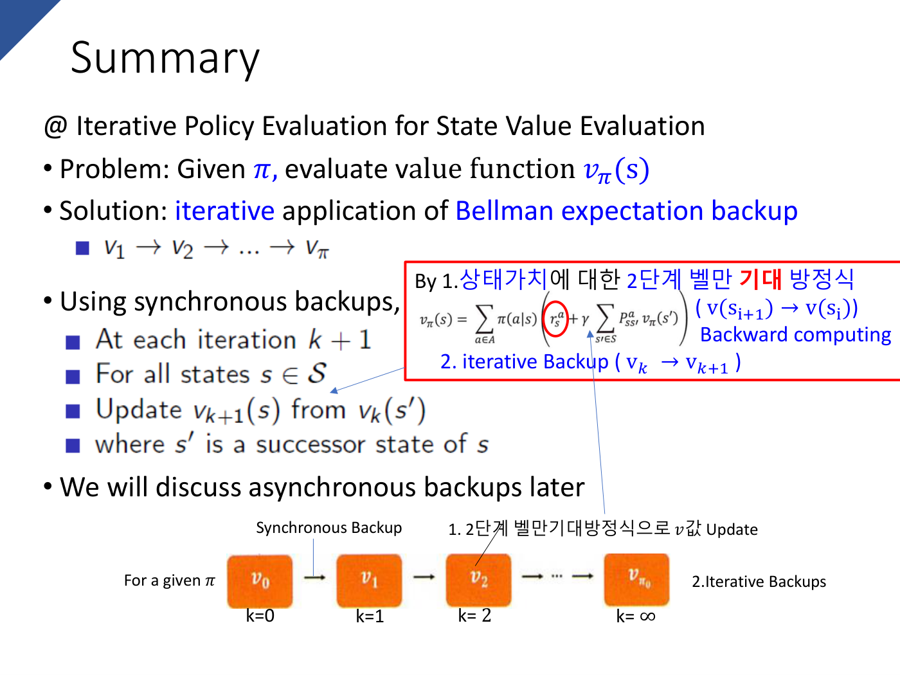
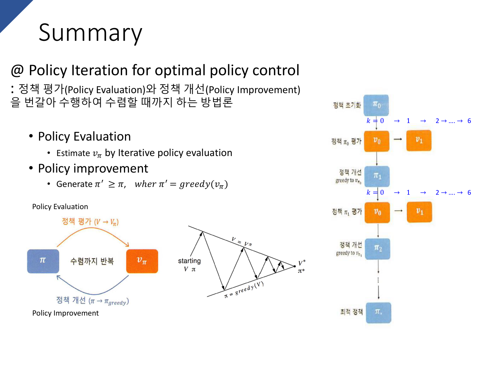
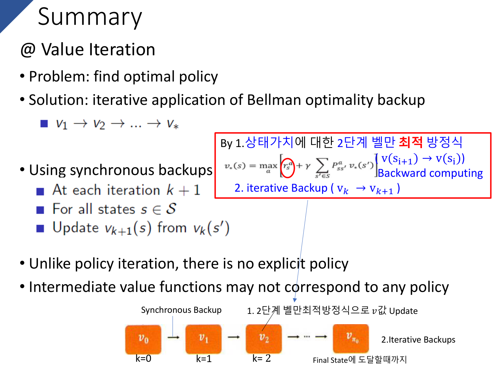

# Planning by Dynamic Programming

원본 [10-04-Planning by Dynamic Programming V07.pdf](https://drive.google.com/file/d/1WzxCPUjXw1EHjXmS3HuInU36N_AIr8xd/view?usp=drivesdk)

## Model-Based Planning과 Bellman Backup

Dynamic Programming은 전이 확률 $P_{ss'}^a$와 기대 보상 $r_s^a$를 알고 있을 때, 미래 상태의 가치 계산을 재사용해 큰 문제를 작은 부분문제로 푼다(8`11쪽). 아래의 $k$는 환경의 시간 $t$가 아니라 가치 테이블의 반복 번호다.

### Iterative Policy Evaluation

정책 $\pi$를 고정하고 모든 비종료 상태를 다음 식으로 갱신한다.

$$
v_{k+1}(s)=\sum_{a\in A}\pi(a\mid s)
\left(r_s^a+\gamma\sum_{s'\in S}P_{ss'}^a v_k(s')\right).
$$

1. $v_0$을 초기화하고 종료 상태 가치를 0으로 고정한다.
2. Synchronous Backup에서는 같은 $v_k$로 모든 $v_{k+1}$을 계산한다.
3. 보충 구현에서 $\max_s|v_{k+1}(s)-v_k(s)|<\theta$를 종료 기준으로 쓸 수 있다. $\theta$는 허용 오차다.

예를 들어 한 상태의 두 행동 선택 확률이 0.5씩이고, 각각 즉시 보상과 다음 상태 가치가 $(-1,4)$, $(-1,0)$이면 $\gamma=0.9$에서 갱신값은 $0.5(2.6)+0.5(-1)=0.8$이다.

### Policy Iteration

1. 현재 $\pi$에 대해 Iterative Policy Evaluation을 수행한다.
2. 각 상태에서 $q_\pi(s,a)=r_s^a+\gamma\sum_{s'}P_{ss'}^a v_\pi(s')$를 계산한다.
3. $\pi'(s)\in\arg\max_a q_\pi(s,a)$로 정책을 개선한다.
4. 정책이 안정될 때까지 평가와 개선을 반복한다. 동률 처리 순서를 고정하면 같은 점수의 행동 사이에서 정책이 계속 바뀌는 일을 막을 수 있다.

### Value Iteration

정책 평가를 수렴까지 하는 내부 반복을 두지 않고, 매 회 최적 Backup을 한다.

$$
v_{k+1}(s)=\max_a\left[r_s^a+\gamma\sum_{s'\in S}P_{ss'}^a v_k(s')\right].
$$

앞의 두 행동 예에서는 평균 0.8 대신 $\max(2.6,-1)=2.6$이다. 수렴 후 $v$로 각 행동의 점수를 계산해 Greedy Policy를 추출한다. Policy Iteration은 한 정책을 평가한 후 개선하며, Value Iteration은 가치 갱신 단계부터 최댓값을 적용한다(27`35쪽).

### Synchronous vs. Asynchronous Backup

Synchronous 방식은 전 상태를 한 묶음으로 갱신한다. Asynchronous 방식은 일부 상태부터 갱신하고 이미 바뀐 값을 재사용할 수 있다. 유한 할인 MDP에서 관련 상태가 계속 선택되면 적절한 비동기 Backup도 수렴한다. Grid World에서는 목표 상태에 가까운 곳부터 갱신하면 새로운 값이 먼 곳으로 더 빨리 전달될 수 있다(36, 42쪽).

## Original Slides

아래 도판에는 원본의 수식·기호·첨자와 강의 예시를 그대로 담았다. 본문의 유도식과 손계산은 개념을 이해하기 위한 해설이다.

### PDF p. 20

### PDF p. 28

### PDF p. 38

### PDF p. 39

### PDF p. 40

