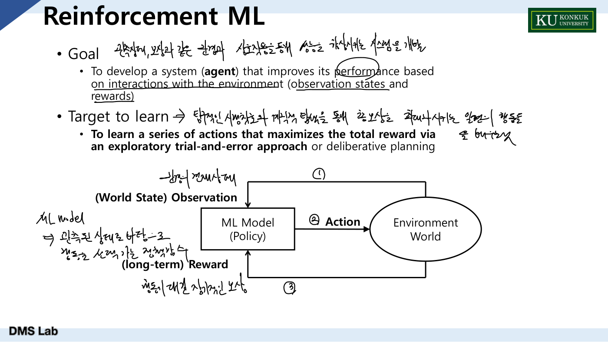
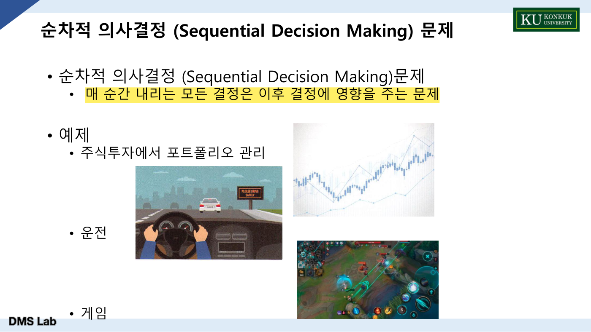

# Reinforcement Learning Problem

원본 [09-01-DRL Problem V01.pdf](https://drive.google.com/file/d/1qOuOmGE6JLJRfB0BfpF3bkWs1nwMH4kO/view?usp=drivesdk)

## Agent, Environment, Policy

Agent는 관측을 받아 행동하고 Environment는 그 행동의 결과인 다음 관측과 보상을 돌려준다. Policy는 관측이나 상태를 입력으로 받아 행동 또는 행동의 확률분포를 정한다. 원본 5`7쪽의 그림에서는 행동이 환경으로, 보상과 관측이 에이전트로 돌아오는 순환을 보여준다.

## Sequential Decision Making

행동은 현재 보상뿐 아니라 다음 상태와 그 뒤에 선택할 수 있는 행동에도 영향을 준다. 바둑의 한 수, 게임에서 이동 방향 선택, 운전 중 차선 변경이 원본의 사례다. 자전거를 타면서 피드백을 받고 행동을 개선하는 예는 상호작용을 통한 학습을 직관적으로 보여준다.

### 보충 계산 · Return

원본의 총보상 목표는 다음 MDP 강의에서 $G_t=R_{t+1}+\gamma R_{t+2}+\cdots$로 형식화된다. 예를 들어 두 번 선택하는 상황에서 첫 행동 A의 보상이 3이고 다음 보상이 0이면 $G_t=3$이다. B의 첫 보상이 0이고 다음 보상이 5라면 $\gamma=0.9$일 때 $G_t=4.5$여서 B가 더 가치 있다.

1. 현재 관측을 얻고 Policy에 따라 행동한다.
2. 다음 관측과 보상을 기록한다.
3. 보상과 이후 결과를 사용해 Policy나 Value Function을 갱신한다.
4. 이 과정을 반복해 새로운 상황에서 누적 보상이 개선되는지 확인한다.

Supervised Learning에서는 각 입력에 대한 목표 출력이 주어지고, Unsupervised Learning에서는 입력의 구조를 찾는다. Reinforcement Learning에서는 각 상태의 정답 행동 대신 환경의 보상 신호를 받아 판단을 개선한다(2`6쪽).

## Original Slides

아래 도판에는 원본의 수식·기호·첨자와 강의 예시를 그대로 담았다. 본문의 유도식과 손계산은 개념을 이해하기 위한 해설이다.

### PDF p. 5

### PDF p. 7

