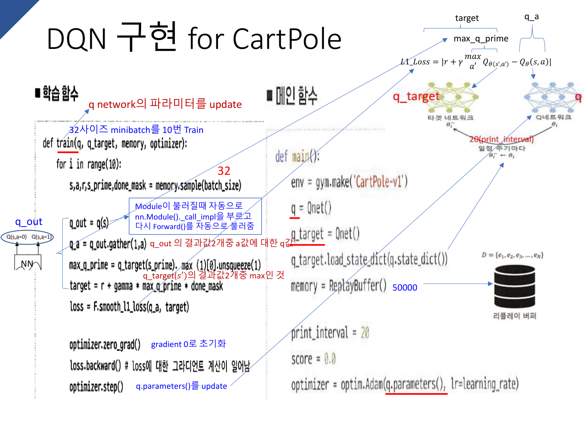
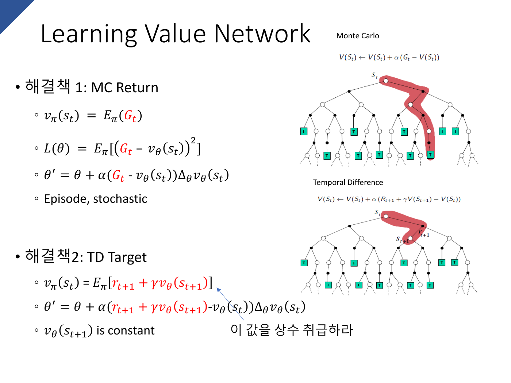
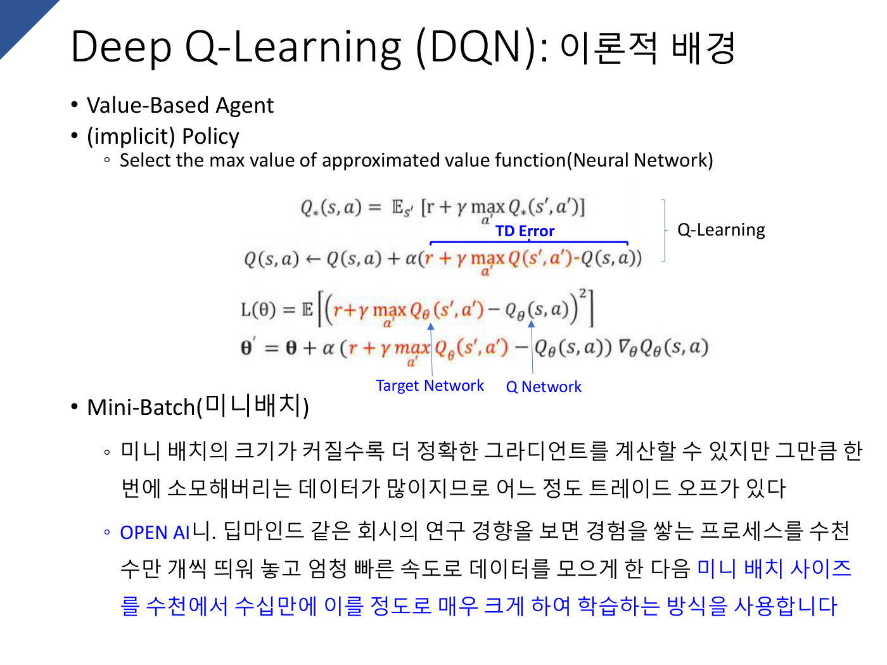
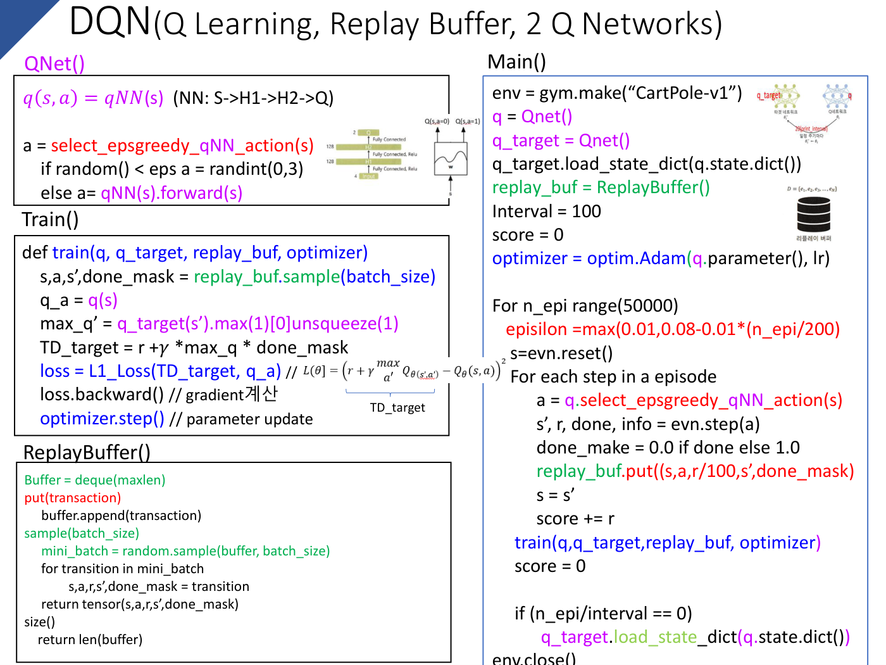

# Value-Based Agent and Deep Q-Network

원본 [14-Value-Based Agent V08.pdf](https://drive.google.com/file/d/1g7k6-UTIKIHsYGwgnPXyWmubmhJZDCOJ/view?usp=drivesdk)

## Value Function Approximation

상태 공간이 너무 크거나 연속이면 상태마다 Q-table의 행을 만들기 어렵다. 신경망은 파라미터를 여러 상태에 공유해 본 적 없는 유사 상태에도 가치를 추정한다. Value-Based Agent는 $q_\theta(s,a)$로부터 Greedy 또는 ε-Greedy Policy를 간접적으로 얻는다. Policy-Based Agent는 정책 $\pi(a\mid s)$를 직접 표현한다(6`10쪽).

원본 11`12쪽의 고정 정책 Value Network는 MC Return을 쓸 때 $L(\theta)=E_\pi[(G_t-v_\theta(s_t))^2]$를 사용한다. 해당 슬라이드의 갱신식을 Gradient 표기로 옮기면

$$
\theta'=\theta+\alpha(G_t-v_\theta(s_t))\nabla_\theta v_\theta(s_t).
$$

TD에서는 $G_t$ 자리에 $r_{t+1}+\gamma v_\theta(s_{t+1})$을 넣고 그 Target을 상수로 취급하는 Semi-Gradient를 쓴다. 제곱 오차 미분에서 나오는 상수 2는 이 갱신식의 학습률에 흡수된 표기다.

## Deep Q-Network · CartPole

강의는 DQN을 **Q-Learning + Experience Replay + Separate Target Network**로 설명한다(13`24쪽). CartPole에서는 관측 벡터 4개를 입력하고 좌우 두 행동에 대한 Q값을 출력한다. 배치 크기가 $B$라면 출력 크기는 $(B,2)$다.

$$
q_a=Q_\theta(s,a),\qquad
\mathrm{TD\_target}=r+\gamma\max_{a'}Q_{\theta^-}(s',a')\cdot\mathrm{done\_mask}.
$$

$\theta$는 Online Network, $\theta^-$는 Target Network의 파라미터다. 원본 24쪽의 $L1\_\mathrm{Loss}$ 표기를 따르면 개별 샘플의 절대오차는 $|\mathrm{TD\_target}-q_a|$다. 배치에서 평균을 내 학습하면 각 전이의 오차가 함께 반영된다.

### Training Loop

1. Online Network의 ε-Greedy로 행동한다. CartPole의 행동 인덱스는 0과 1이다.
2. Replay Buffer에 $(s,a,r,s',\mathrm{done\_mask})$를 저장한다. 원본 예제의 $r/100$은 학습용 보상 스케일이고 화면에 출력하는 Score는 원래 보상을 합산한다.
3. Buffer에서 미니배치를 무작위로 뽑는다. 시간상 붙어 있는 전이만 연속 사용하면 데이터의 상관관계가 커지므로 여러 시점의 경험을 섞는다.
4. `q(states).gather(1, actions)`로 샘플마다 실제 수행한 행동의 Q값을 가져온다. Target 쪽은 `q_target(next_states).max(dim=1, keepdim=True).values`로 계산하고 기울기 추적을 끈다.
5. Loss → `zero_grad()` → `backward()` → `step()` 순서로 Online Network를 갱신한다.
6. 정한 주기마다 `q_target.load_state_dict(q.state_dict())`로 복사한다. 중간에는 Target Network를 고정해 양쪽 추정치가 함께 흔들리는 정도를 줄인다.

예를 들어 $q_a=1.4$, $r=1$, $\gamma=0.9$, 다음 상태의 최대 Target Q가 2이면 일반 전이의 타깃은 2.8이고 절대오차는 1.4다. 실제 종료라면 마스크 0으로 타깃은 1, 절대오차는 0.4다.

> 구현 보충. Gymnasium에서 에피소드 루프는 `terminated or truncated`면 끝낸다. 시간 제한이 환경 밖에서 걸린 경우에는 보통 `terminated`만으로 Bootstrapping을 끈다. 실제 종료와 시간 제한을 모두 `done`으로 뭉친 원본 예제를 옮길 때 주의할 점이다. 또한 주기 판정은 `episode % interval == 0`이고, CartPole의 행동은 환경의 Action Space에 맞춰 샘플링한다.

## Original Slides

아래 도판에는 원본의 수식·기호·첨자와 강의 예시를 그대로 담았다. 본문의 유도식과 손계산은 개념을 이해하기 위한 해설이다.

### PDF p. 12

### PDF p. 14

### PDF p. 21

### PDF p. 24

