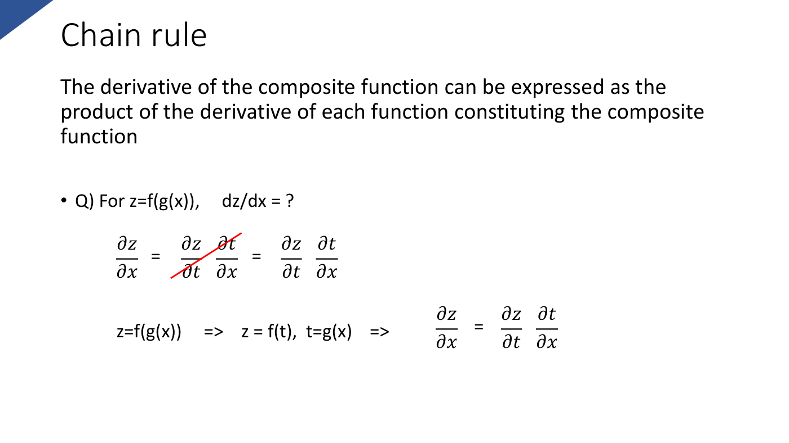
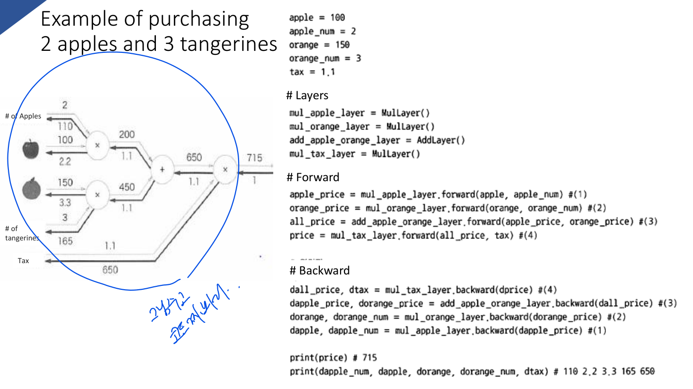
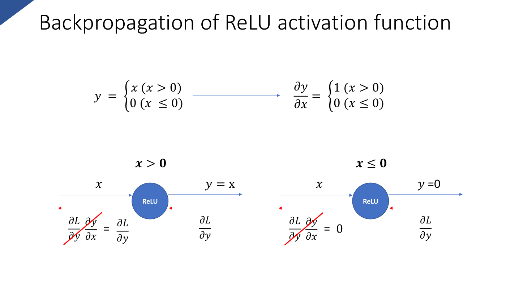
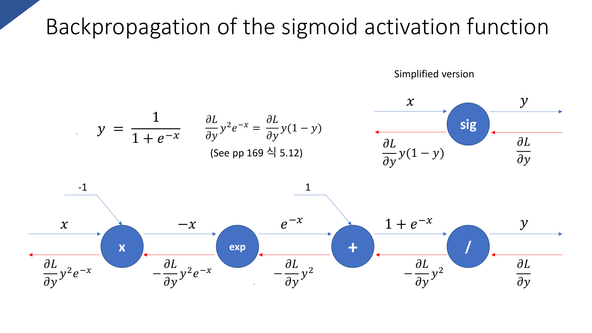
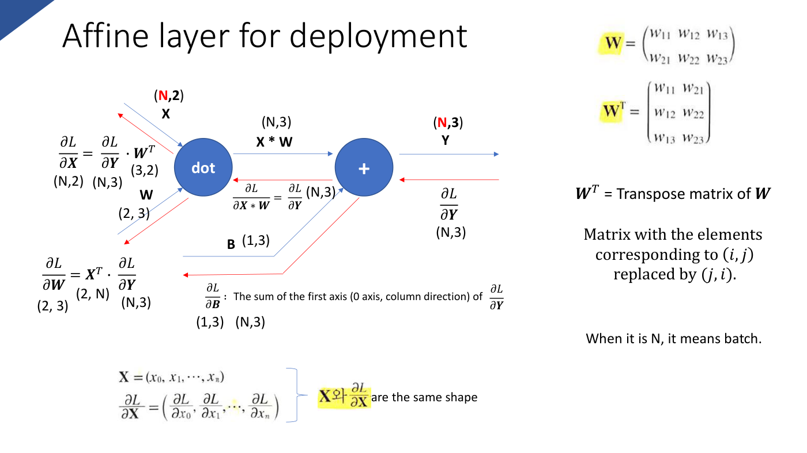
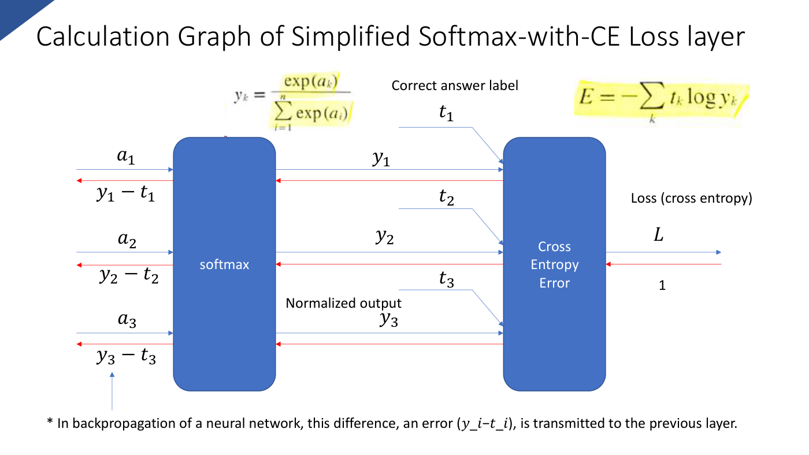
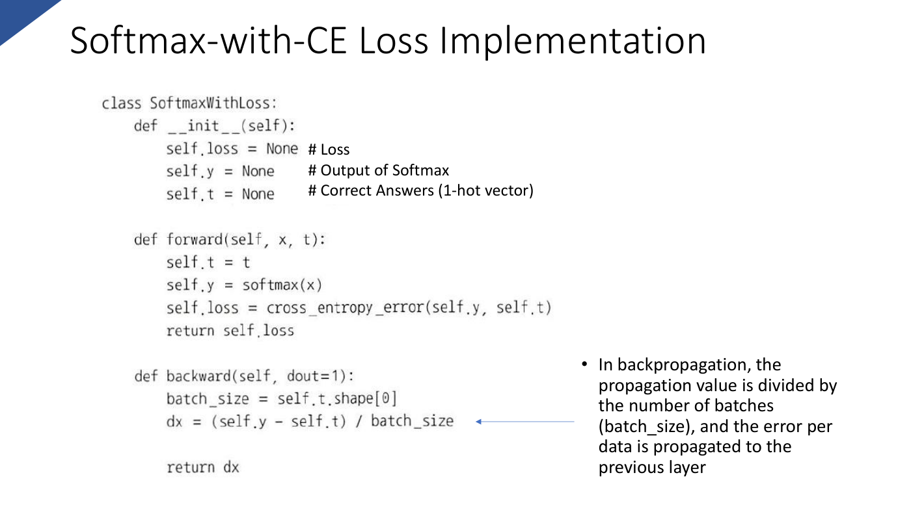

# Error Backpropagation

원본 [07-Error Backpropagation(long) V08.pdf](https://drive.google.com/file/d/1vaVkpZR1ioH7WvTCvXlhIfx9ZXnAK9yh/view?usp=drivesdk)

## 1. Computation Graph and Chain Rule
순전파는 입력에서 손실까지 국소 연산을 차례로 적용하고, 역전파는 손실에 대한 각 변수의 기울기를 출력에서 입력 방향으로 계산한다. 노드가 $y=f(x)$이고 다음 노드에서 $g_y=\partial L/\partial y$를 받으면

$$
g_x=g_y\frac{\partial y}{\partial x}.
$$

하나의 값이 두 경로에서 쓰이면 각 경로가 전달한 기울기를 합한다. 예를 들어 $t=x+y$, $z=t^2$라면 $\partial z/\partial x=2t\cdot1=2(x+y)$다. $x=y$처럼 같은 변수를 두 입력에 사용한 $z=(x+x)^2$에서는 두 경로의 기울기를 합해 $8x$가 된다(7~20쪽).

## 2. Add and Multiply Layers
덧셈 $z=x+y$의 역전파에서는 상류 기울기 $g_z$를 두 입력에 똑같이 보낸다. 곱셈 $z=xy$에서는 $g_x=g_z y$, $g_y=g_z x$이므로 순전파 입력을 저장한다.

사과 단가 $a=100$, 수량 $n=2$, 귤 단가 $b=150$, 수량 $m=3$, 세율 배수 $t=1.1$인 원본 25쪽 예제에서 $L=(an+bm)t=715$다. 역전파는 $g_L=1$에서 시작한다.

| 변수 | 미분 | 값 | 해석 |
|---|---|---:|---|
| 세율 배수 $t$ | $an+bm$ | 650 | 배수에 대한 총액 변화율 |
| 사과 소계·귤 소계 | 각각 $t$ | 1.1 | 합 노드에서 같은 기울기를 전달 |
| 사과 단가 $a$ | $tn$ | 2.2 | 사과 단가 변화에 따른 총액 변화율 |
| 사과 수량 $n$ | $ta$ | 110 | 사과 한 개의 세금 포함 단가 |
| 귤 단가 $b$·수량 $m$ | $tm$, $tb$ | 3.3, 165 | 곱 노드에서 반대편 입력을 곱함 |

## 3. ReLU, Sigmoid, and Affine Layers

원본 32쪽의 $\partial L/\partial Y$를 아래 유도에서 $G$로 줄여 쓴다. 원본 35쪽의 Softmax 출력은 $y_i$, 정답은 $t_i$, 로짓은 $a_i$이며 아래 배치 설명의 $P,T,Z$에 각각 대응한다.
- **ReLU**. $y=\max(0,x)$이면 $g_x=g_y\mathbf1(x>0)$이다. 원점의 미분값은 구현에서 보통 0으로 정한다. 순전파에서 저장한 양수 마스크로 기울기를 통과시킨다.
- **Sigmoid**. $y=\sigma(x)=1/(1+e^{-x})$를 미분하면 $e^{-x}/(1+e^{-x})^2=y(1-y)$다. 저장한 출력 $y$로 $g_x=g_y y(1-y)$를 계산한다. $|x|$가 클 때 미분값이 작다.

배치가 행 방향인 $Y=XW+b$에서 $X:(B,d)$, $W:(d,k)$, $Y:(B,k)$이고 $G=\partial L/\partial Y$라고 하자.

$$
\frac{\partial L}{\partial X}=GW^\top,\qquad
\frac{\partial L}{\partial W}=X^\top G,\qquad
\frac{\partial L}{\partial b}=\sum_{i=1}^B G_{i,:}.
$$

$Y_{ik}=\sum_jX_{ij}W_{jk}+b_k$이므로 $W_{jk}$의 미분은 $\sum_i X_{ij}G_{ik}$다. 같은 bias가 모든 행에 더해져 배치 축의 기울기를 더한다. 예를 들어 $X=[[1,2],[3,4]]$, $G=[[0.5],[-0.5]]$라면 $dW=[[-1],[-1]]$, $db=0$이다(26~33쪽).

## 4. Softmax-with-Loss
$P=\mathrm{softmax}(Z)$이고 정답 원-핫 행렬을 $T$라 두면 평균 교차 엔트로피는 $L=-B^{-1}\sum_{i,k}T_{ik}\log P_{ik}$다. 한 행에서 $\log p_k=z_k-\log\sum_j e^{z_j}$이므로

$$
\frac{\partial L}{\partial Z}=\frac{P-T}{B}.
$$

예를 들어 배치가 1개이고 $P=(0.7,0.2,0.1)$, $T=(0,1,0)$이면 로짓 기울기는 $(0.7,-0.8,0.1)$이다. 배치 평균이면 $B$로 나누고 합 손실이면 나누지 않는다. 평균 배율은 한 번만 적용한다(34~37쪽).

## 5. Implementation and Gradient Check
1. 순전파에서 Affine → ReLU 또는 Sigmoid → Affine → Softmax-with-Loss 순서로 계산하고, 각 층이 역전파에 필요한 입력·마스크·출력을 보관한다.
2. 손실의 자기 미분 $dL/dL=1$부터 시작해 반대 순서로 각 층의 `backward`를 호출한다.
3. 각 층의 $dW,db$를 모으고 옵티마이저가 파라미터를 갱신한다. 역전파는 기울기를 구하는 알고리즘이고 SGD는 그 기울기로 이동량을 정하는 알고리즘이다.
4. 작은 네트워크에서 중심차분 $[L(\theta+h)-L(\theta-h)]/(2h)$과 해석적 기울기를 비교한다. 동일한 입력·라벨·모델 상태를 유지하고, ReLU의 꺾이는 점 근처에서 차이가 날 수 있음을 고려한다. 수치 미분은 가중치마다 순전파를 다시 수행하지만 역전파는 순전파에서 저장한 계산을 공유한다(38~43쪽).

## Original Slides

아래 도판에는 원본의 수식·기호·첨자와 강의 예시를 그대로 담았다. 본문의 유도식과 손계산은 개념을 이해하기 위한 해설이다.

### PDF p. 15

### PDF p. 25

### PDF p. 26

### PDF p. 29

### PDF p. 32

### PDF p. 35

### PDF p. 37

