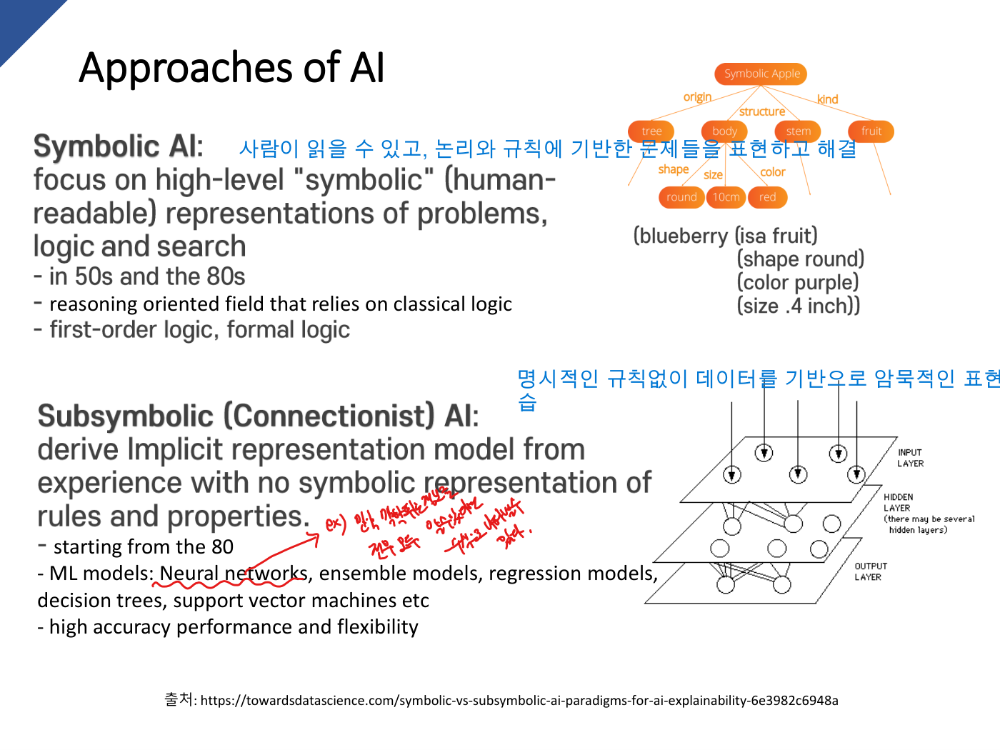
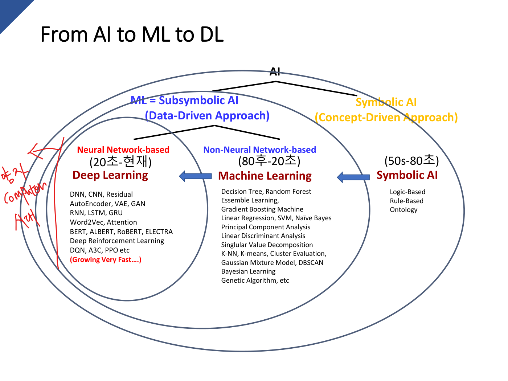

# Introduction to AI

원본 [02-1-Intro to AI V03.pdf](https://drive.google.com/file/d/1kG2VG2TxU9NxavraeCSqIxF9UiXNhZ2W/view?usp=drivesdk)

## 1. Intelligent Agent
에이전트는 환경에서 관측을 얻고, 가능한 행동 중 목표 달성에 도움이 되는 행동을 고른다. 예를 들어 이동 로봇은 센서로 장애물을 관측하고, 전진·회전·정지 중 하나를 선택한다. 인식 문제는 관측의 의미를 파악하는 데 초점을 두고, 의사결정 문제는 그 정보를 바탕으로 행동을 선택하는 데 초점을 둔다. 강의는 계산처럼 규칙을 적기 쉬운 문제에서 음성·영상 인식처럼 규칙을 직접 적기 까다로운 문제로 관심이 넓어진 점을 강조한다(5~8쪽).

## 2. Symbolic AI and Data-Driven AI

| 접근 | 표현 | 처리 과정 | 강의 예시 |
|---|---|---|---|
| 기호적 AI | 논리, 규칙, 온톨로지 | 사실을 입력하고 적용 가능한 규칙을 찾아 결론을 도출한다 | 사람이 작성한 규칙으로 패턴 판별 |
| 전통적인 머신러닝 | 설계한 특징과 학습한 모델 | 특징 벡터에서 예측에 유용한 경계나 관계를 추정한다 | 붓꽃 분류의 결정 트리, 영상 특징 추출의 SIFT |
| 딥러닝 | 신경망의 가중치와 중간 표현 | 입력에서 특징 추출과 예측을 하나의 학습 목표로 최적화한다 | 이미지에서 직접 분류 결과를 출력하는 종단 간 학습 |

강의의 AI → ML → DL 관계는 범위의 포함 관계로 이해하면 된다. 결정 트리·SVM·선형회귀도 머신러닝에 속하며, 신경망을 쓰는 CNN과 DQN은 각각 영상 처리와 강화학습에 적용되는 딥러닝 사례다. 강의 타임라인은 1956년 다트머스 회의, 1980년대 전문가 시스템의 성장, 1980년대 말부터의 AI 겨울을 주요 전환점으로 제시한다(9~15, 30~32쪽). 전문가 시스템에서는 사람이 지식과 규칙을 입력하므로 적용할 상황이 늘수록 지식을 관리하는 부담이 커진다.

## 3. Rule-Based, Decision Tree, and Deep Learning
붓꽃 분류에서는 꽃잎과 꽃받침의 길이·너비를 표로 정리할 수 있다(16~26쪽).

1. **규칙 기반**. 사람이 꽃잎 길이와 임계값을 비교하는 규칙을 작성한다. 규칙의 적용 이유를 추적하기 쉽고, 새로운 예외가 생기면 사람이 수정한다.
2. **결정 트리**. 라벨이 있는 훈련 데이터에서 후보 특징과 임계값을 평가한다. 라벨이 한쪽에 더 잘 모이는 분할을 택해 하위 노드에서 반복한다. 추론할 때는 루트부터 조건을 따라가 잎에서 클래스를 고른다.
3. **딥러닝**. 이미지 자체를 받는다면 신경망이 입력에서 중간 특징을 만들고 클래스 점수를 출력한다. 정답에서 계산한 손실을 역전파해 특징 추출층과 분류층의 파라미터를 함께 갱신한다.

**Worked Example**. 결정 트리가 Gini 불순도를 쓰는 경우, 노드의 클래스 비율을 $p_k$라 하면 $G=1-\sum_k p_k^2$다. A·B가 반씩 섞이면 $G=0.5$이고 한 클래스만 남으면 $G=0$이다. 분할 전 Gini에서 두 자식의 표본 수 가중평균 Gini를 뺀 값이 클수록 라벨이 잘 분리된다.

## 4. Probability and Statistical Inference
확률은 가정한 모형에서 관측이 나올 가능성을 계산한다. 통계적 추론은 관측된 데이터로 모형이나 모수에 관한 결론을 내린다(27~29쪽). 분류에 비유하면 훈련에서는 데이터로 $\theta$를 추정하고, 추론에서는 학습한 $\theta$를 사용해 새 $x$의 클래스 점수나 확률을 계산한다.

## Original Slides

아래 도판에는 원본의 수식·기호·첨자와 강의 예시를 그대로 담았다. 본문의 유도식과 손계산은 개념을 이해하기 위한 해설이다.

### PDF p. 9

### PDF p. 30

