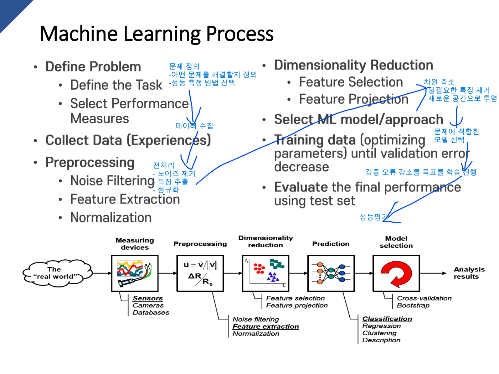
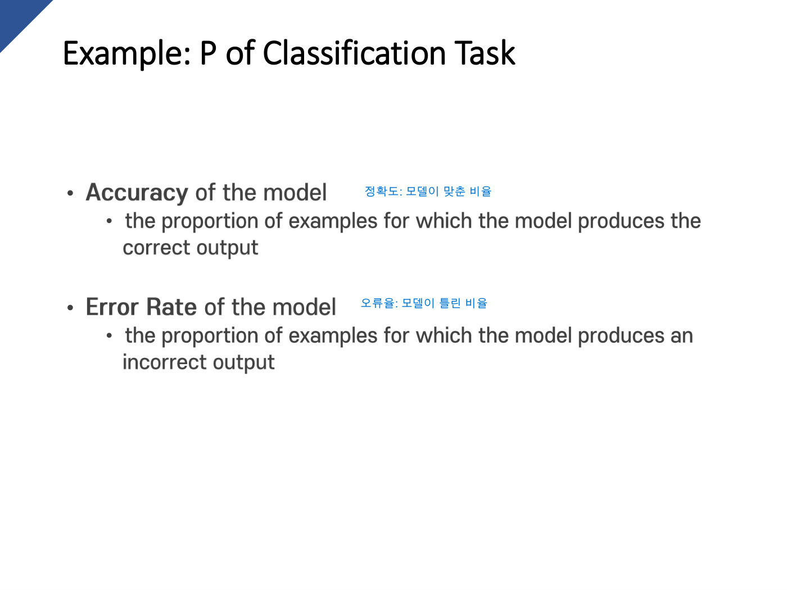

# Introduction to Machine Learning

원본 [02-2-Intro to ML V03.pdf](https://drive.google.com/file/d/1NQ1qq4WPz9GQUjFuerhxWaw-CURzUNdU/view?usp=drivesdk)

## 1. Task, Performance Measure, and Experience
머신러닝은 **경험 $E$**를 얻으면서 **과제 $T$**에서 **성능 지표 $P$**로 측정한 성능이 향상되는 과정이다. 스팸 필터의 $T$는 새 이메일의 스팸 여부 분류, $E$는 라벨이 붙은 이메일, $P$는 보지 않은 이메일에서 측정한 정확도나 오류율이다. 데이터 증가, 병렬 연산 능력, 딥러닝 알고리즘 발전이 학습 적용을 넓혔다. 빅데이터의 3V는 양(Volume), 종류(Variety), 발생 속도(Velocity)를 뜻한다(3~14쪽).

## 2. Machine Learning Tasks and Metrics

| 과제 | 출력 | 예시 |
|---|---|---|
| 분류 | 이산 클래스 | 스팸 필터, 손글씨 숫자 판별 |
| 회귀 | 연속값 | 입력 특징으로 점수 예측 |
| 군집화 | 데이터로부터 발견한 그룹 | 고객 세분화 |
| 전사·번역 | 문자 또는 문장 시퀀스 | 음성→텍스트, 언어 간 번역 |
| 구조화 출력 | 여러 요소의 관계를 담은 구조 | 문장 구문 트리 |
| 이상 감지·합성 | 이상 점수·새 표본 | 비정상 관측 탐지, 이미지 생성 |

분류 정확도는 $N^{-1}\sum_i\mathbf1(\hat y_i=y_i)$이고, 전체 샘플에 한 번씩 예측하면 오류율은 $1-\mathrm{Accuracy}$다. 100건 중 95건을 맞히면 각각 0.95와 0.05다. 실제 스팸이 5건이면 전부 정상으로 분류해도 95%가 나오므로 스팸 재현율 $TP/(TP+FN)$도 함께 봐야 스팸 검출 성능을 알 수 있다. 회귀의 MSE는 $N^{-1}\sum_i(\hat y_i-y_i)^2$이며 단위가 타깃 단위의 제곱이다(16~25쪽).

## 3. Supervised, Unsupervised, and Reinforcement Learning

| 유형 | 주어진 신호 | 학습 결과 |
|---|---|---|
| 지도학습 | 입력 $x_i$와 정답 $y_i$ | 새 입력에 대한 분류 또는 회귀 함수 |
| 비지도학습 | 정답 없이 모은 입력 $x_i$ | 군집, 저차원 표현 등 |
| 강화학습 | 행동 뒤 얻는 관측과 보상 | 장기 누적 보상을 높이는 정책 |

지도학습은 보통 $\theta^*=\arg\min_\theta N^{-1}\sum_i\ell(f_\theta(x_i),y_i)$로 쓴다. $\ell$은 샘플별 손실이고 $f_\theta$는 예측 함수다. **보충**으로 강화학습의 할인 수익은 $G_t=\sum_{k\ge0}\gamma^k r_{t+k+1}$이다. $\gamma$는 미래 보상의 가중치다. 체스 예제처럼 승패가 끝에 주어져도 이전 행동을 포함한 정책의 성과를 평가한다. 로지스틱 회귀의 출력은 클래스 확률이고 일반적으로 분류 과제로 사용한다(26~35쪽).

## 4. Spam Filtering Pipeline
1. 과제와 지표를 정하고 라벨을 확보한다.
2. 훈련·검증·테스트로 나눈다. 수신자 수와 이메일 길이처럼 입력 특징을 정의하고, 정규화나 차원 축소에 필요한 통계는 훈련 데이터에서 구한다.
3. 훈련셋으로 예측 모델의 파라미터를 학습한다. 선형 분류기라면 $w_1x_1+w_2x_2+b$의 부호로 두 영역을 나눌 수 있다.
4. 검증셋으로 모델과 설정을 비교하고, 선택을 마친 뒤 테스트셋에서 일반화 성능을 평가한다.

## Original Slides

아래 도판에는 원본의 수식·기호·첨자와 강의 예시를 그대로 담았다. 본문의 유도식과 손계산은 개념을 이해하기 위한 해설이다.

### PDF p. 11

### PDF p. 25

