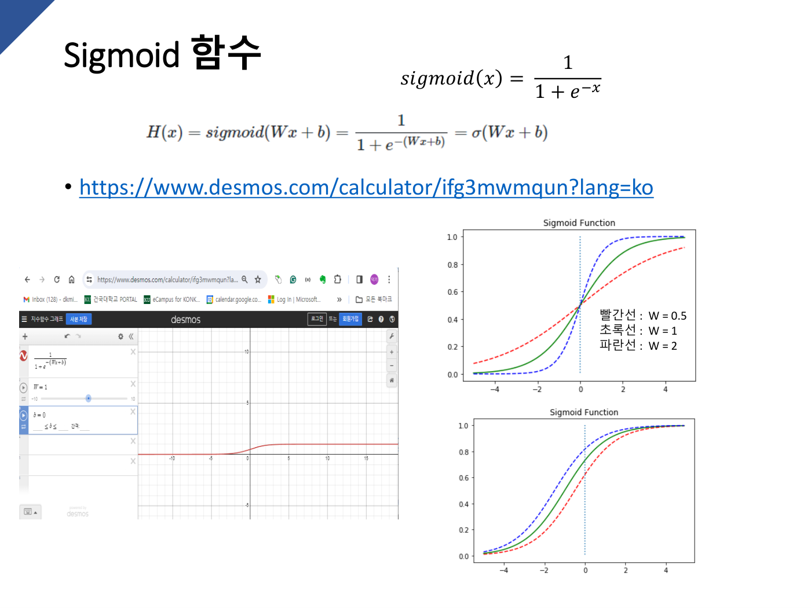
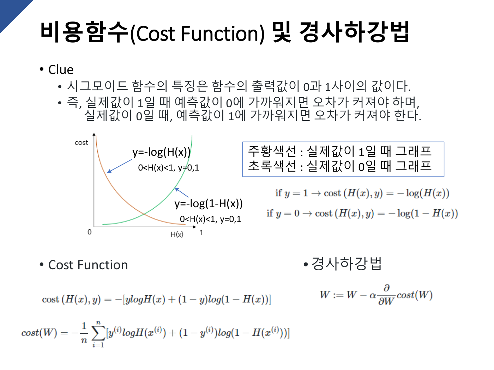
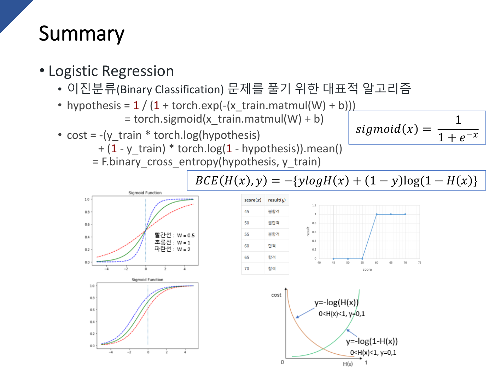

# Logistic Regression

원본 [04-01-Logistic Regression V02.pdf](https://drive.google.com/file/d/1JCR_Q4Qi9nmfJBA_Y4zQdNafB2-CeLeO/view?usp=drivesdk)

## 1. Logit, Sigmoid, and Decision Boundary
이진 분류에서 $z=w^\top x+b$는 로짓이고 $p=\sigma(z)=1/(1+e^{-z})$는 클래스 1의 예측 확률이다. $p/(1-p)=e^z$이므로 $z$는 로그 오즈다. 기본 임계값 $p=0.5$는 $z=0$에 해당하므로 결정 경계는 $w^\top x+b=0$이다. $z$의 변화량은 로그 오즈를 같은 크기로 움직이고, 확률 변화량은 현재 $z$에 의존한다(4~5쪽).

## 2. Binary Cross Entropy and Gradient

원본은 Class 1의 예측 확률을 $H(x)$로 적는다. 원본 7, 14쪽과 본문을 대조할 때 아래의 $p$가 $H(x)$에 해당한다.
정답 $y\in\{0,1\}$에 대해 베르누이 우도는 $p^y(1-p)^{1-y}$다. 음의 로그를 취하면 샘플별 Binary Cross Entropy가 된다.

$$
\ell(p,y)=-y\log p-(1-y)\log(1-p).
$$

$y=1$이면 $-\log p$, $y=0$이면 $-\log(1-p)$만 남는다. $y=1$을 $p=0.8$로 예측하면 손실 약 0.223이고, $p=0.1$이면 약 2.303이다.

$$
\frac{\partial\ell}{\partial p}=-\frac{y}{p}+\frac{1-y}{1-p},\quad
\frac{\partial p}{\partial z}=p(1-p),\quad
\frac{\partial\ell}{\partial z}=p-y.
$$

따라서 평균 손실의 $\nabla_w J=n^{-1}\sum_i(p_i-y_i)x_i$이고 $\partial J/\partial b=n^{-1}\sum_i(p_i-y_i)$다. 시그모이드 뒤에 MSE를 쓰면 로짓 미분에 $p(1-p)$가 남아 확신을 가지고 틀린 샘플도 기울기가 작아질 수 있다. 선형 로짓의 BCE는 로짓에 대한 이차 미분이 $p(1-p)\ge0$이므로 가중치에 대해서도 볼록하다(6~7쪽).

## 3. Training and Inference
1. `nn.Linear(d,1)`에서 로짓을 계산한다.
2. 강의 방식은 `torch.sigmoid(logits)`를 `F.binary_cross_entropy(probabilities, y)`에 전달한다.
3. 동등한 보충 구현으로 `F.binary_cross_entropy_with_logits(logits, y)`가 있다. 로짓에서 직접 계산하면 극단적 확률의 로그를 안정적으로 다룰 수 있다.
4. `zero_grad()` → `backward()` → `step()`으로 학습한다. 타깃은 로짓과 같은 모양의 실수형 0 또는 1을 사용한다.
5. 추론에서 클래스만 필요하면 `logits >= 0`을 사용한다. 확률이 필요할 때 시그모이드를 적용한다.

원본의 `nn.Sequential(nn.Linear(2,1), nn.Sigmoid())`와 `BinaryClassifier` 클래스는 둘 다 2개 특징을 받아 같은 확률 계산을 수행한다(8~15쪽).

## Original Slides

아래 도판에는 원본의 수식·기호·첨자와 강의 예시를 그대로 담았다. 본문의 유도식과 손계산은 개념을 이해하기 위한 해설이다.

### PDF p. 5

### PDF p. 7

### PDF p. 14

