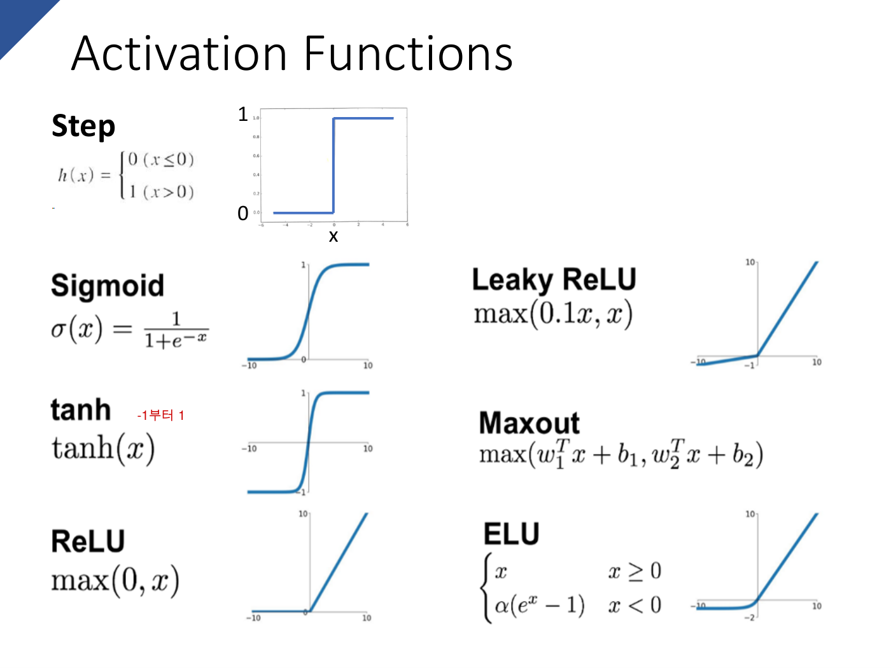
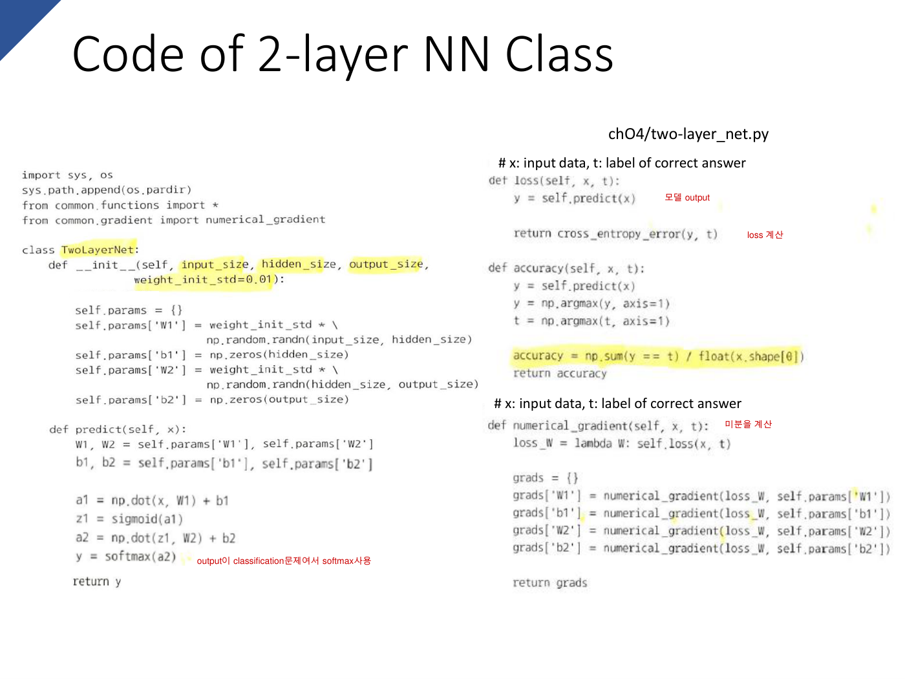
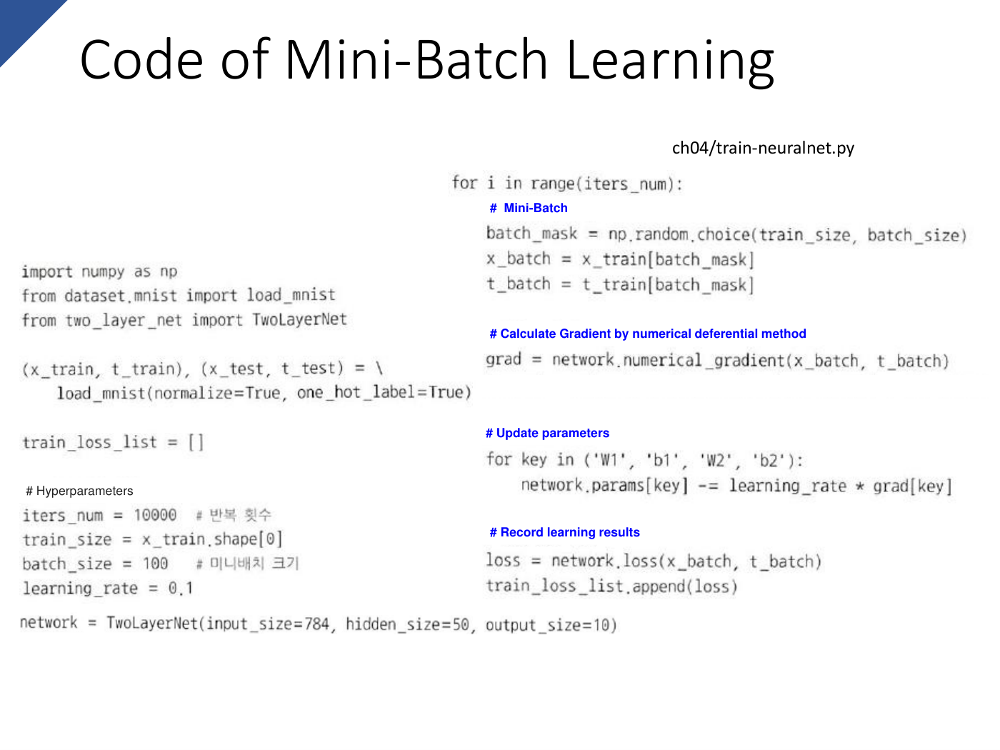
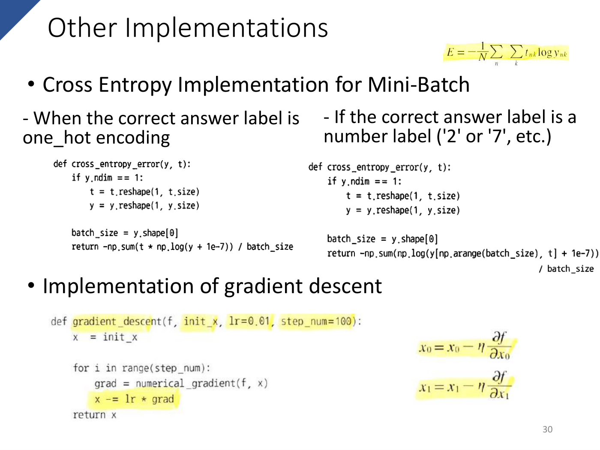
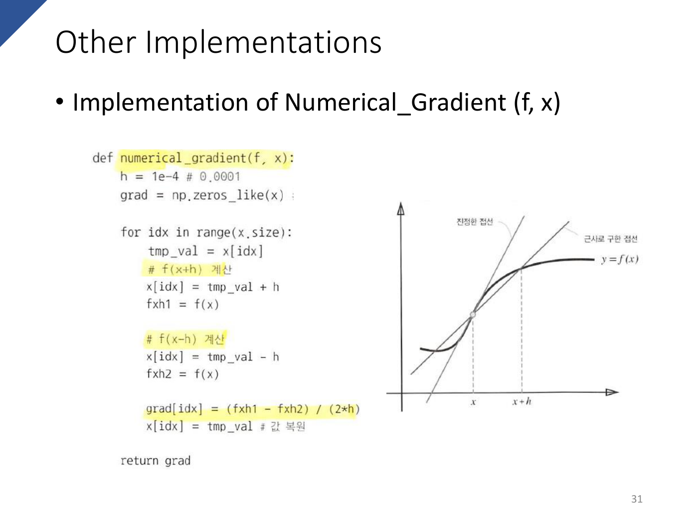

# MNIST Classification with MLP

원본 [05-MLP로 MNIST 분류하기 (Summary) V02.pdf](https://drive.google.com/file/d/1Ajxu0Mpyz1BWba2nniBCfCbBoU8x6PCw/view?usp=drivesdk)

## 1. Model, Inputs, and Outputs
MNIST 샘플은 $28\times28$ 흑백 손글씨 이미지와 0~9 정답이다. 픽셀을 길이 784 벡터로 펼치고 배치 크기를 $B$, 은닉 뉴런 수를 $H$로 두면 강의의 2층 모델을 아래처럼 쓸 수 있다(3~11, 23~25쪽).

$$
A=XW_1+b_1,\quad U=\sigma(A),\quad Z=UW_2+b_2,\quad P=\mathrm{softmax}(Z).
$$

| 값 | 크기 | 의미 |
|---|---|---|
| $X$ | $(B,784)$ | 픽셀을 펼친 이미지 배치 |
| $W_1$, $b_1$ | $(784,H)$, $(H,)$ | 입력에서 은닉 특성 생성 |
| $U$ | $(B,H)$ | 활성화 함수가 적용된 은닉 특성 |
| $W_2$, $b_2$ | $(H,10)$, $(10,)$ | 은닉 특성에서 클래스 점수 생성 |
| $P$ | $(B,10)$ | 행마다 합이 1인 확률 |

$\sigma(a)=1/(1+e^{-a})$이며 강의는 ReLU 등 다른 활성화 함수도 소개한다. 은닉 비선형성이 입력을 새 표현으로 바꾸며, 두 가중치 행렬이 함께 학습되므로 픽셀에서 분류까지 종단 간으로 최적화할 수 있다.

## 2. Cross Entropy and Accuracy
정답 클래스 인덱스를 $c_i$라 하면 $J=-B^{-1}\sum_i\log P_{i,c_i}$다. 예를 들어 정답 클래스 확률이 0.8과 0.2인 두 샘플의 평균 손실은 $(-\log 0.8-\log0.2)/2\approx0.9163$이다. 정확도는 $B^{-1}\sum_i\mathbf1(\arg\max_k Z_{ik}=c_i)$다. 순위가 유지되더라도 정답 확률이 달라지면 교차 엔트로피는 달라지므로 학습의 진행을 더 세밀하게 볼 수 있다(11~17쪽).

## 3. Mini-Batch Training and Numerical Gradient
1. 훈련 입력과 라벨에서 미니배치를 구성한다.
2. $Z$와 $J$를 계산한다. 원-핫 정답을 사용하면 $J=-B^{-1}\sum_{i,k}T_{ik}\log P_{ik}$와 같다.
3. 강의의 초기 NumPy 예제는 각 매개변수 $\theta_j$를 $+h,-h$로 바꾼 뒤 $\big[J(\theta+h e_j)-J(\theta-h e_j)\big]/(2h)$를 계산한다. $e_j$는 $j$번째 좌표만 1인 벡터이며, 양쪽 계산 뒤 원래 값을 복원한다. $f(w)=w^2,w=2,h=0.01$의 예에서는 $(4.0401-3.9601)/0.02=4$다.
4. 모든 기울기를 모은 다음 동시에 $\theta\leftarrow\theta-\eta\nabla_\theta J$로 갱신한다. 각 좌표마다 순전파가 두 번 필요한 수치 미분은 작은 예제나 검증에 적합하다. 보통의 학습에는 같은 그래프를 활용하는 역전파를 사용한다.
5. 배치 손실을 기록하고 epoch 단위로 정확도를 확인한다. 훈련셋으로 파라미터를 갱신하고, 검증셋으로 설정을 선택하며, 테스트셋은 최종 성능을 측정한다(19~31쪽).

Iteration은 배치 한 번 갱신이다. 데이터를 중복 없이 모두 도는 셔플 방식에서 $N=10{,}000,B=50$이면 200회가 1 epoch다. 강의처럼 무작위 추출을 반복하면 $N/B$회는 데이터셋 크기만큼 뽑았다는 의미의 기준이며 중복·누락이 생길 수 있다.

## 4. Backpropagation Derivation
$D=(P-T)/B$로 두면 $dW_2=U^\top D$, $db_2=\sum_iD_i$다. 은닉 로짓의 미분은 $D_1=(DW_2^\top)\odot U\odot(1-U)$이고 $dW_1=X^\top D_1$, $db_1=\sum_i(D_1)_i$다. $\odot$는 원소별 곱이다. 뒤 층에서 오는 기울기에 각 층의 국소 미분을 곱해 앞 층으로 전달한다.

## Original Slides

아래 도판에는 원본의 수식·기호·첨자와 강의 예시를 그대로 담았다. 본문의 유도식과 손계산은 개념을 이해하기 위한 해설이다.

### PDF p. 6

### PDF p. 25

### PDF p. 26

### PDF p. 30

### PDF p. 31

