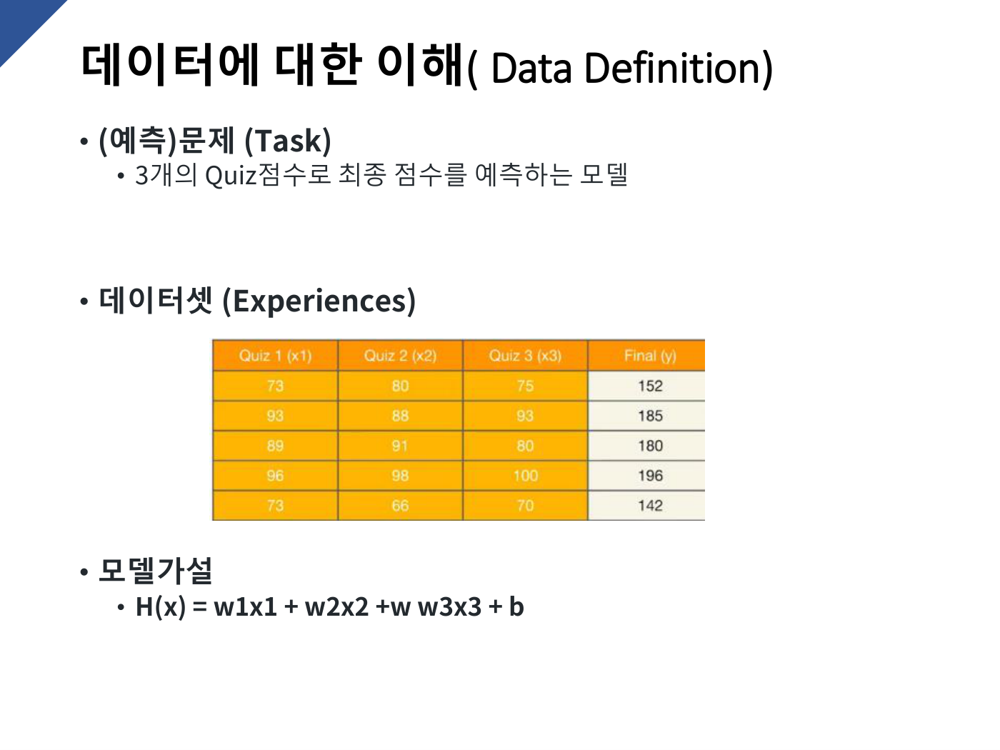
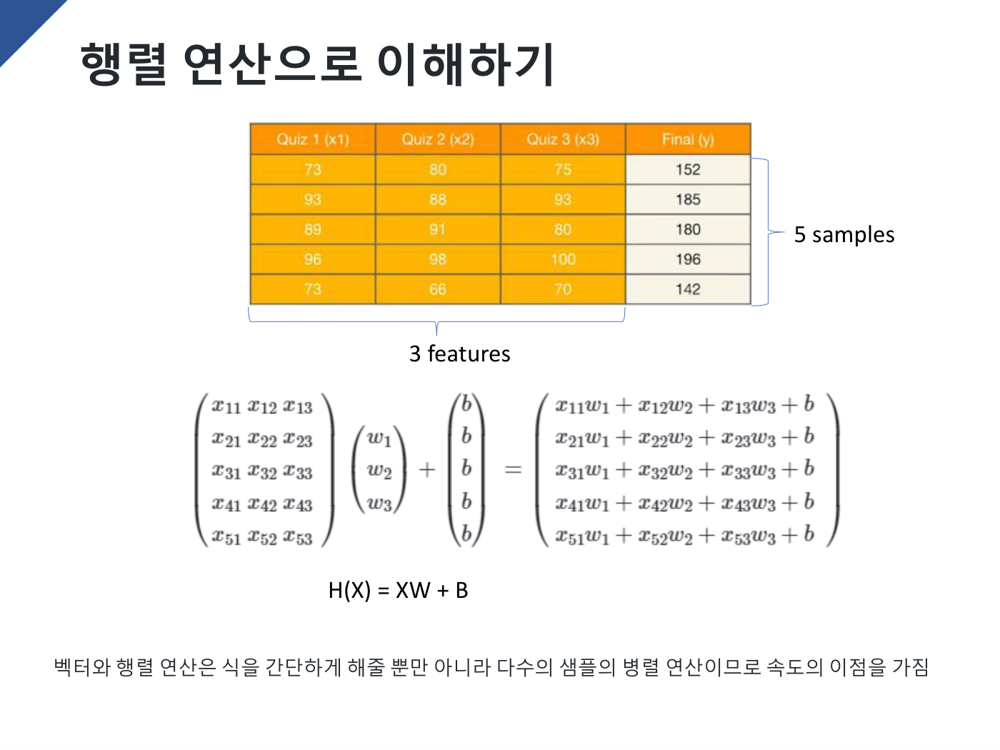
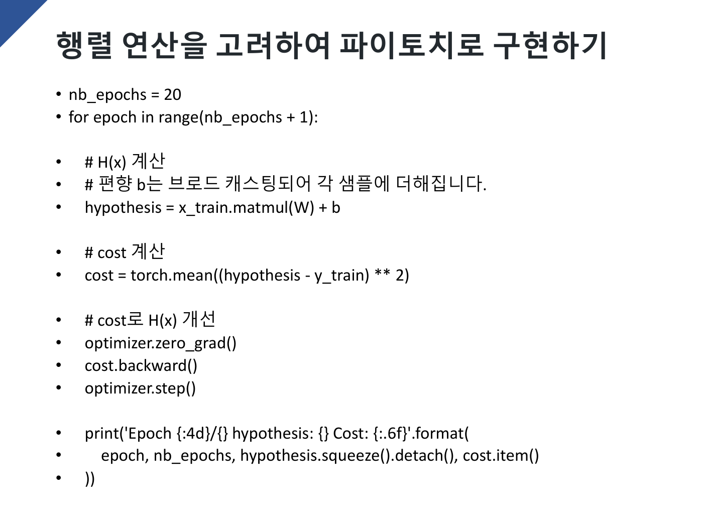

# Multivariable Linear Regression

원본 [03-02-Multivariable LR V02.pdf](https://drive.google.com/file/d/1pTEJo25uyQiH7vt42vYx8Fsm_XuJumYB/view?usp=drivesdk)

## 1. Hypothesis, Dot Product, and Matrix Multiplication

원본 8쪽의 행렬식은 $H(X)=XW+B$다. $B$는 각 행에 같은 편향이 더해지는 모습을 나타낸다. 아래 유도에서는 이를 $b\mathbf1$로 표시한다.
$H(x)=w_1x_1+w_2x_2+w_3x_3+b$에서 $x_j$는 $j$번째 퀴즈 점수이고 $w_j$는 다른 입력을 고정했을 때의 효과다. 한 학생의 입력은 행벡터이고, 한 행과 가중치 열벡터의 내적이 한 학생의 점수 예측을 만든다. 샘플 5개를 한꺼번에 계산하면

$$
\hat y=Xw+b\mathbf1,\quad
X:(5,3),\quad w:(3,1),\quad \hat y,y:(5,1).
$$

$b$는 각 행에 같은 값으로 더한다. 행렬 곱의 가운데 차원 3은 입력 특징 수다. 예를 들어 첫 입력 $(73,80,75)$, $w=(0.5,0.5,0.5)^\top$, $b=0$이면 예측은 114이며 정답 152에 대한 제곱 오차는 $(-38)^2=1444$다(2~8쪽).

## 2. Vectorized MSE and Gradient
$e=\hat y-y$로 두면 $J=e^\top e/n$이다. $\partial e_i/\partial w_j=X_{ij}$이므로

$$
\frac{\partial J}{\partial w_j}=\frac2n\sum_i X_{ij}e_i,\qquad
\nabla_wJ=\frac2nX^\top e,\qquad \frac{\partial J}{\partial b}=\frac2n\mathbf1^\top e.
$$

$X^\top e$는 $(3,5)(5,1)=(3,1)$이다. 각 특징에 대해 모든 샘플의 잔차와 특징 값을 곱해 더한다. 모든 파라미터를 0으로 초기화하면 첫 잔차는 $-y$이므로 양수인 점수 특징에서는 첫 기울기가 음수, 첫 갱신은 양수 방향이다.

## 3. PyTorch Implementations
1. 입력을 특징별 열 3개로 관리하면 `x1*w1 + x2*w2 + x3*w3 + b`다.
2. 입력을 $(5,3)$ 행렬로 쌓으면 `prediction = X @ w + b`다. 두 구현에 같은 데이터를 쓰면 계산이 같다.
3. `loss = ((prediction - y)**2).mean()`으로 MSE를 구한다.
4. `optimizer.zero_grad()` → `loss.backward()` → `optimizer.step()` 순서로 반복한다.

자료의 학습률 $10^{-5}$는 입력 점수가 대략 70~100점인 예제에서 쓰는 값이다. $\nabla_w J$가 특징 크기에 영향을 받으므로 입력 척도가 커지면 적정 학습률도 달라진다. 보충으로 특징을 표준화한다면 훈련셋에서 구한 평균과 표준편차를 검증·테스트에도 적용한다.

> 예제 재현 시 확인할 점. 원본 3쪽의 세 번째 학생 세 번째 점수는 90이고, 9쪽 행렬 예제는 80이다. 두 구현을 비교하는 경우 3쪽의 90으로 통일한다.

## Original Slides

아래 도판에는 원본의 수식·기호·첨자와 강의 예시를 그대로 담았다. 본문의 유도식과 손계산은 개념을 이해하기 위한 해설이다.

### PDF p. 2

### PDF p. 8

### PDF p. 10

