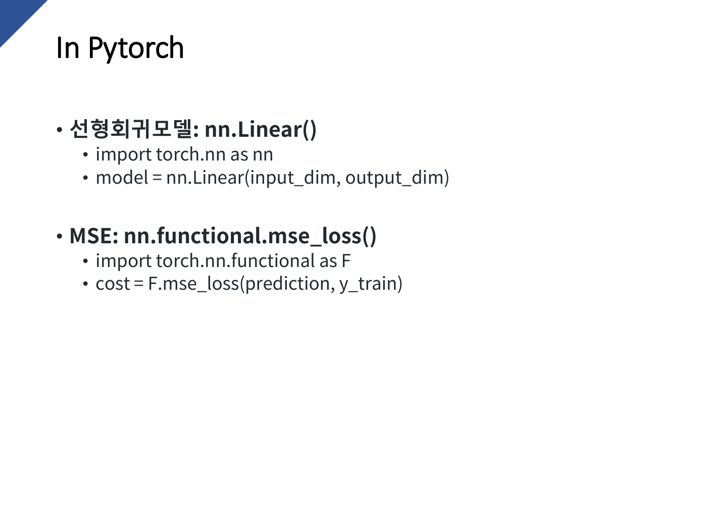
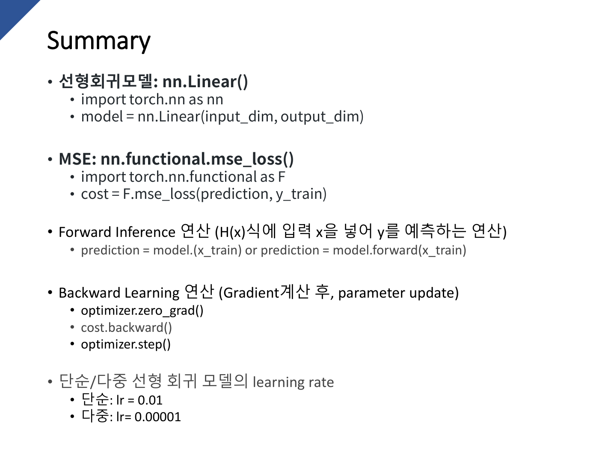

# Linear Regression with nn.Module

원본 [03-03-nn.Module로 구현하는 선형회귀.pdf](https://drive.google.com/file/d/1lRxTF4h0PIvnSMTwPu6Eb9QCdWOnfD6E/view?usp=drivesdk)

## 1. nn.Linear and Tensor Shapes
`nn.Linear(d,k)`는 $d$개 특징에서 $k$개 값을 출력하는 아핀 모형이다. 배치 기준 $Y=XW^\top+b$이고 모듈이 저장하는 $W$의 크기는 $(k,d)$, $b$는 $(k,)$다. 직접 구현에서 $Xw+b$로 쓰는 열벡터 $w:(d,1)$는 `nn.Linear(d,1).weight.T`에 해당한다.

| 모델 | 입력 | 저장 weight | 출력 | 파라미터 수 |
|---|---|---|---|---|
| `nn.Linear(1,1)` | $(n,1)$ | $(1,1)$ | $(n,1)$ | 2 |
| `nn.Linear(3,1)` | $(n,3)$ | $(1,3)$ | $(n,1)$ | 4 |

예를 들어 `weight = [[0.8,0.7,0.5]]`, `bias = [1]`이면 첫 학생 $(73,80,75)$의 예측은 $58.4+56+37.5+1=152.9$다.

## 2. Training Loop
```python
import torch
from torch import nn
from torch.nn import functional as F

def fit(x_train, y_train, lr, epochs=2000):
    model = nn.Linear(x_train.shape[1], 1)
    optimizer = torch.optim.SGD(model.parameters(), lr=lr)
    for _ in range(epochs):
        optimizer.zero_grad()
        prediction = model(x_train)
        cost = F.mse_loss(prediction, y_train)
        cost.backward()
        optimizer.step()
    return model
```

`model.parameters()`는 학습할 weight와 bias를 옵티마이저에 넘긴다. 기본 평균 MSE의 예측값 미분은 $\partial J/\partial\hat y_i=2(\hat y_i-y_i)/n$이고, 역전파는 여기에 $\partial\hat y_i/\partial W_{1j}=X_{ij}$를 곱해 샘플별 기여를 합친다. 원본은 단순 회귀에 0.01, 다중 회귀에 $10^{-5}$를 쓴다(3~7쪽). 직접 구현 코드의 0 초기화와 달리 모듈에는 자체 초기값이 있어 학습 로그가 달라질 수 있다.

## 3. Implementation Checks
- 타깃을 예측과 동일한 $(n,1)$로 만든다. $(n,)$이면 브로드캐스팅에 의해 두 축이 생겨 모든 조합의 오차가 계산될 수 있다.
- `model(x)`로 모듈을 호출한다. 이 경로에서 `forward`가 실행되며 모듈 훅 등 호출 기능도 유지된다.
- 학습 후 예측만 필요할 때는 `torch.no_grad()` 블록에서 새 입력을 넘긴다. 한 학생의 특징 3개도 $[1,3]$ 모양으로 넣으면 출력 형태가 일관된다.

## Original Slides

아래 도판에는 원본의 수식·기호·첨자와 강의 예시를 그대로 담았다. 본문의 유도식과 손계산은 개념을 이해하기 위한 해설이다.

### PDF p. 2



### PDF p. 7


