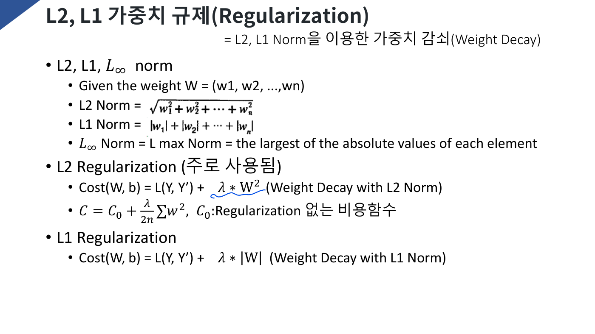
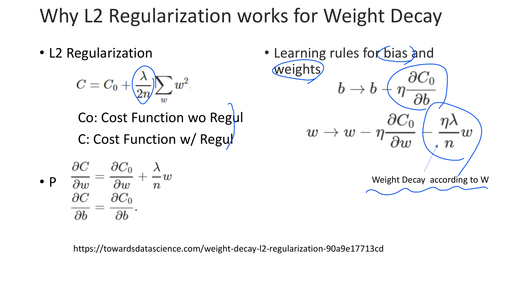
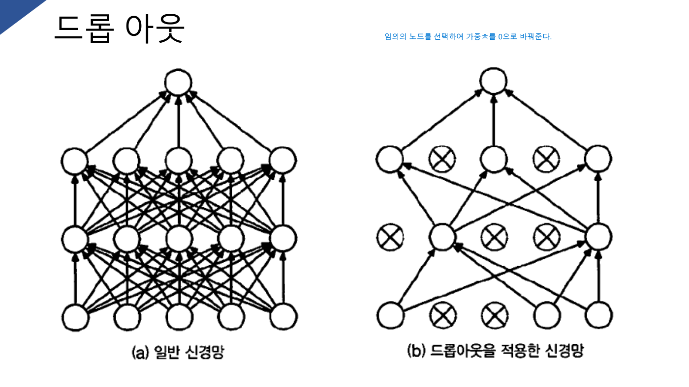

# Overfitting and Regularization

원본 [06-01-Overfitting 해결법 V01.pdf](https://drive.google.com/file/d/11bqeHnRoNEjEEnnkqt_NXruryeAAaLAZ/view?usp=drivesdk)

## 1. Overfitting, Data Augmentation, and Capacity
과적합은 모델이 훈련 데이터의 세부 패턴에 지나치게 맞춰 새로운 데이터에서 성능이 떨어지는 현상이다. 훈련 정확도는 계속 오르는데 검증 정확도가 정체하거나 검증 손실이 상승할 수 있다. 강의는 MNIST 훈련/평가 정확도 차이로 이를 보인다(2~6쪽).

- **Data Collection and Data Augmentation**. 샘플을 더 모으거나 훈련 이미지에 회전·노이즈 등을 적용한다. 원래 라벨이 유지되는 정도의 변환을 사용하고, 원본에서 파생된 여러 샘플은 같은 데이터 분할에 둔다.
- **Model Capacity Reduction**. 은닉층 수나 너비를 줄이면 표현 용량이 줄어 훈련 데이터의 개별 패턴을 외우기 어려워진다. 너무 작으면 훈련과 검증 성능이 함께 낮을 수 있다.
- **Small Weight Initialization**. 초기 가중치를 정하는 방법이다. 학습 과정에서 가중치 크기를 지속적으로 제한하려면 별도의 규제항 등을 사용한다.

## 2. L1 and L2 Regularization and Weight Decay
벡터 $w$의 $\|w\|_1=\sum_j|w_j|$, $\|w\|_2=\sqrt{\sum_j w_j^2}$, $\|w\|_\infty=\max_j|w_j|$다. 보통 L2 규제는 **L2 노름의 제곱**을 더한다. 식의 계수는 표기 관례에 따라 다르며 강의는 $\lambda/(2n)$ 형태를 제시한다(7~10쪽).

$$
J_{\rm L2}=J_0+\frac{\lambda}{2n}\sum_jw_j^2,\qquad
w_j^+=\left(1-\frac{\eta\lambda}{n}\right)w_j
      -\eta\frac{\partial J_0}{\partial w_j}.
$$

$J_0$는 예측 손실이고 $\lambda$는 규제 강도다. 제곱을 미분하면 $\lambda w_j/n$이 더해져 일반 SGD로 갱신할 때 기존 가중치에 감쇠 계수가 곱해진다. 예를 들어 $w=2,\eta=0.1,\lambda/n=0.05$이고 데이터 손실 기울기가 0이면 다음 $w$는 $1.99$다. 강의처럼 bias를 규제항에서 제외하면 bias 갱신에는 이 항이 없다.

$J_{\rm L1}=J_0+\lambda\sum_j|w_j|$의 규제 기울기는 $w_j\ne0$에서 $\lambda\,\mathrm{sign}(w_j)$이고 0에서는 부분기울기가 $[-\lambda,\lambda]$다. L1은 희소한 해를 유도할 수 있고 L2는 상대적으로 큰 값을 더 강하게 누른다. 보충으로 일반 SGD에서는 결합된 L2와 가중치 감쇠에 위 대응이 있지만, 적응형 옵티마이저에서 손실 기울기에 더하는 L2와 AdamW처럼 분리한 감쇠는 업데이트식이 다르다.

## 3. Dropout
삭제 확률 $p$, 유지 확률 $q=1-p$라 하자. 각 활성값 $h_j$에 대해 $m_j\sim\mathrm{Bernoulli}(q)$로 마스크를 뽑는다. 고전적 표현은 학습 때 $m_jh_j$, 평가 때 $qh_j$다. PyTorch에서 일반적으로 쓰는 inverted dropout은 학습 때 $m_jh_j/q$, 평가 때 $h_j$다. 두 번째 방식의 학습 출력 기댓값은 $h_j$다. 예를 들어 $h_j=3,p=0.25$면 학습 때 75% 확률로 4, 나머지는 0이어서 기댓값이 3이다. 학습에서 활성 출력을 일시적으로 가리고, 평가에서는 `model.eval()`로 마스크를 끈다(11~14쪽).

## 4. Ensemble Learning
- **Voting/평균**. 여러 모델의 클래스 투표를 집계하거나 $\bar p_k=M^{-1}\sum_{m=1}^M p_{mk}$에서 가장 큰 클래스를 고른다.
- **Bagging**. 훈련 데이터에서 복원 추출한 표본으로 여러 모델을 독립 학습한 뒤 예측을 합친다. 랜덤 포레스트는 트리의 분할 후보 특징도 무작위로 제한한다.
- **Stacking**. 여러 기초 모델의 예측을 입력으로 메타 모델을 학습한다. 같은 표본을 학습에 본 기초 모델의 예측을 그대로 메타 훈련에 쓰는 누수를 막기 위해 일반적으로 out-of-fold 예측을 쓴다.

드롭아웃은 학습 중 매번 다른 마스크를 사용하는 점에서 여러 부분 네트워크를 학습하는 것으로 해석할 수 있다(15~19쪽).

## Original Slides

아래 도판에는 원본의 수식·기호·첨자와 강의 예시를 그대로 담았다. 본문의 유도식과 손계산은 개념을 이해하기 위한 해설이다.

### PDF p. 7

### PDF p. 8

### PDF p. 12

