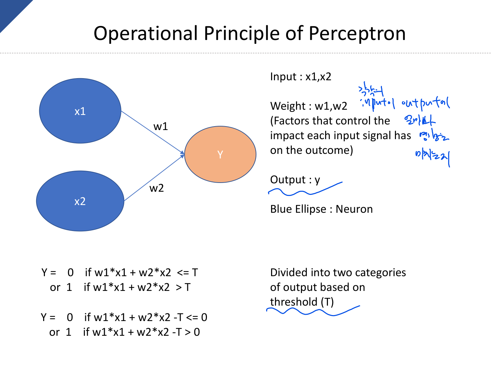
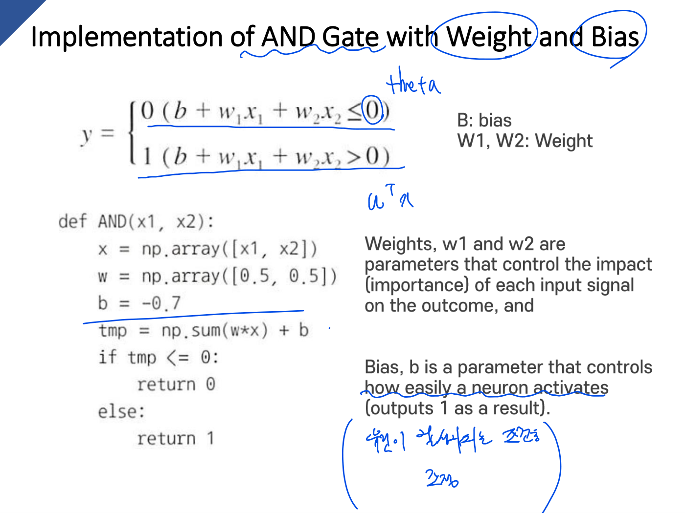
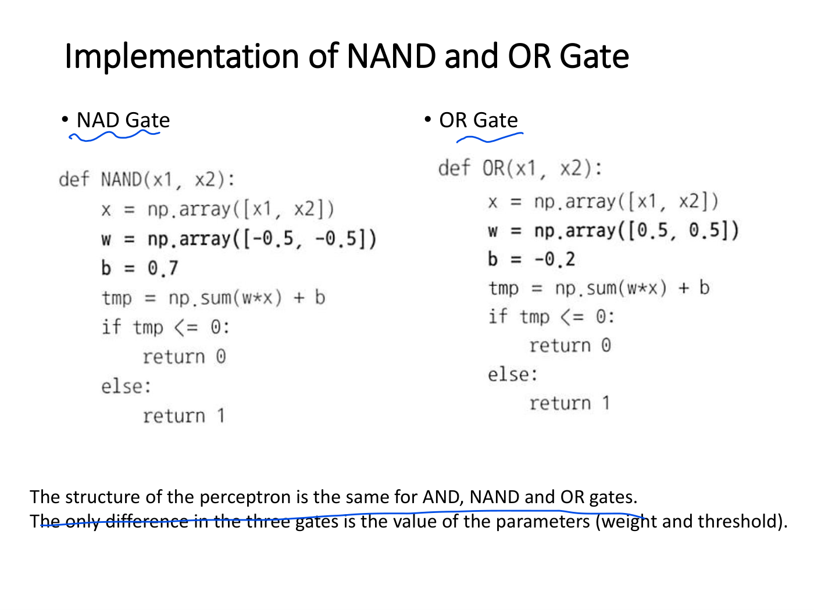
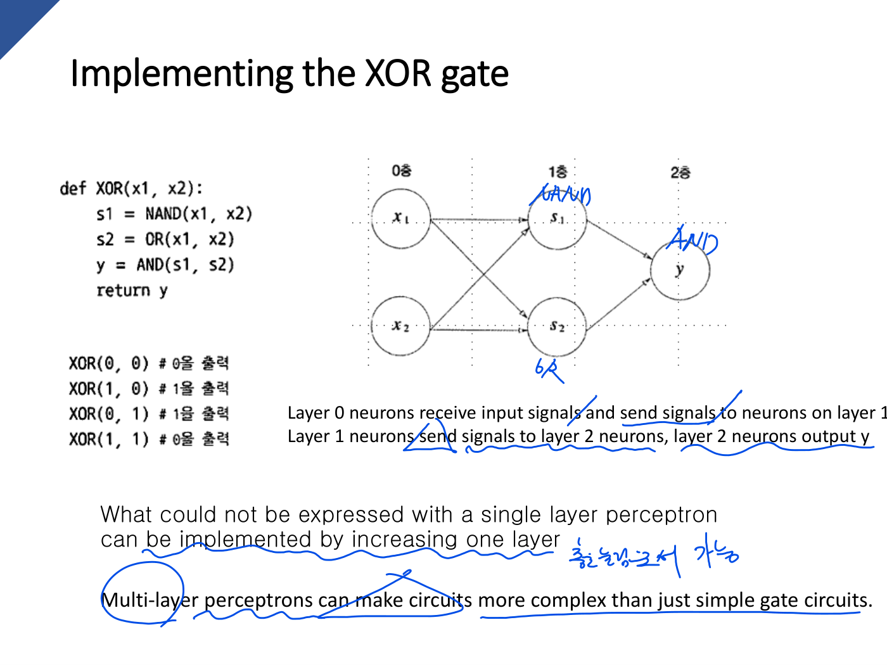

# Perceptron and XOR

원본 [05-02-Perceptron V03.pdf](https://drive.google.com/file/d/1w6sPZCfHsHcuHSWS8oe8iHXxyy7L_GAw/view?usp=drivesdk)

## 1. Artificial Neuron and Logic Gates
퍼셉트론은 가중합 $z=w_1x_1+w_2x_2+b$를 만든 뒤, $z>0$이면 1이고 그 외에는 0을 출력한다. 원래 임계값 표기 $w^\top x>T$에서는 $b=-T$다. 결정 경계 $w^\top x+b=0$은 2차원에서 직선이다(3~14쪽).

| 게이트 | $w_1$ | $w_2$ | $b$ | $(00,01,10,11)$에서 출력 |
|---|---:|---:|---:|---|
| AND | 0.5 | 0.5 | -0.7 | 0, 0, 0, 1 |
| NAND | -0.5 | -0.5 | 0.7 | 1, 1, 1, 0 |
| OR | 0.5 | 0.5 | -0.3 | 0, 1, 1, 1 |

예를 들어 NAND에서 $(1,1)$은 $z=-0.3$, $(1,0)$은 $z=0.2$다. 원본 9쪽에서 음수 가중치와 함께 쓰는 NAND 임계값은 이 규칙을 만족하려면 $T=-0.7$이어야 한다.

**Perceptron Learning Rule · 보충**. $y,\hat y\in\{0,1\}$이면 $w\leftarrow w+\eta(y-\hat y)x$, $b\leftarrow b+\eta(y-\hat y)$로 갱신한다. 양성을 0으로 놓친 경우 가중합을 올리는 방향, 음성을 1로 예측한 경우 내리는 방향으로 움직인다. 강의 후반의 시그모이드 학습은 미분 가능한 연산과 BCE를 사용한다.

## 2. XOR and Linear Separability
$(0,0)$과 $(1,1)$은 0, $(1,0)$과 $(0,1)$은 1이다. 이 출력을 한 뉴런에 요구하면 네 조건이 생긴다.

$$
b\le0,\quad w_1+w_2+b\le0,\quad w_1+b>0,\quad w_2+b>0.
$$

뒤 두 부등식을 더하면 $w_1+w_2+2b>0$이다. 앞 두 식을 더하면 같은 값이 0 이하여야 하므로 모순이다. 시그모이드에 0.5 임계값을 적용해도 경계는 $z=0$이어서 단층의 한계가 유지된다(15~16, 22~23쪽).

## 3. Multilayer Perceptron for XOR
1. 은닉층에서 $h_1=\mathrm{NAND}(x_1,x_2)$와 $h_2=\mathrm{OR}(x_1,x_2)$를 병렬로 계산한다.
2. 출력층에서 $\mathrm{AND}(h_1,h_2)$를 계산한다.
3. $(0,0)$은 은닉값 $(1,0)$, $(1,1)$은 $(0,1)$, 입력이 서로 다르면 $(1,1)$이므로 XOR 진리표가 완성된다.

강의의 학습 예제는 네 샘플을 사용해 단층 `2→1`과 다층 `2→10→10→10→1`을 비교한다. 각 층 사이에 시그모이드를 두고, 마지막 확률에 BCE를 계산해 SGD로 갱신한다. 선형층만 이어 붙이면 아핀 변환 하나로 합쳐져 XOR의 비선형 경계를 표현할 수 없다. 학습 뒤 확률을 0.5로 구분하여 진리표의 네 입력을 모두 검증한다(19~26쪽). NAND의 범용성은 계단 함수 게이트들의 조합이 복잡한 논리 회로도 구성할 수 있음을 보여준다(27~30쪽).

## Original Slides

아래 도판에는 원본의 수식·기호·첨자와 강의 예시를 그대로 담았다. 본문의 유도식과 손계산은 개념을 이해하기 위한 해설이다.

### PDF p. 7

### PDF p. 14

### PDF p. 15

### PDF p. 21

