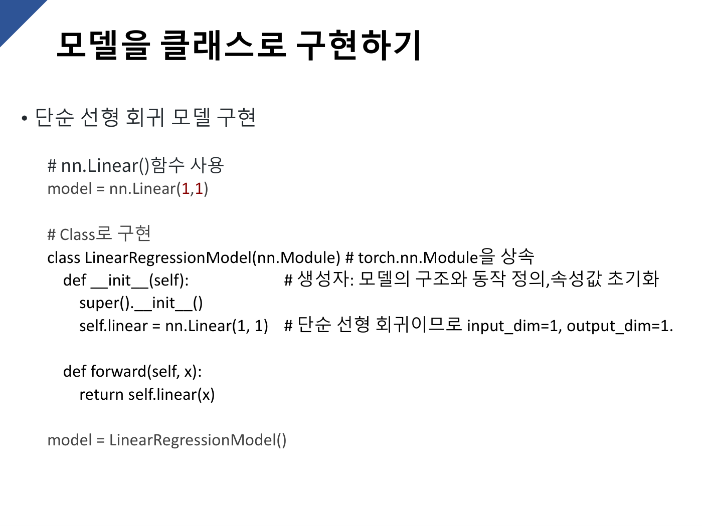
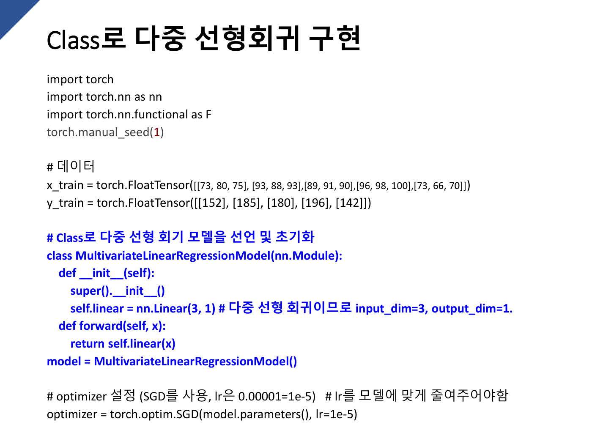

# PyTorch Model Class

원본 [03-04-Class로 파이토치 모델 구현하기.pdf](https://drive.google.com/file/d/19jKHe1MF_wVE6Cygrey36u62eA4_P4Md/view?usp=drivesdk)

## 1. nn.Module and forward
`nn.Module`을 상속하면 여러 연산을 한 모델의 구조로 묶고, 등록된 파라미터를 학습에 사용할 수 있다. 강의에서는 입력 특징이 1개 또는 3개이고, 출력 1개를 만드는 선형회귀를 예제로 쓴다(3~8쪽).

```python
from torch import nn

class LinearRegressionModel(nn.Module):
    def __init__(self, input_dim):
        super().__init__()
        self.linear = nn.Linear(input_dim, 1)

    def forward(self, x):
        return self.linear(x)
```

1. `super().__init__()`로 모듈의 등록 구조를 초기화한다.
2. `self.linear`에 `nn.Linear`를 대입하면 하위 모듈과 그 weight·bias가 등록된다.
3. `forward`에서 실제 입력의 연산 경로를 정의한다.
4. `LinearRegressionModel(1)`과 `LinearRegressionModel(3)`은 같은 클래스를 사용하되 weight의 크기가 각각 $(1,1)$과 $(1,3)$이다.

## 2. Model Equation and Training Loop
$\hat y_i=\sum_{j=1}^d W_{1j}x_{ij}+b_1$이고 $J=n^{-1}\sum_i(\hat y_i-y_i)^2$다. 기울기 $\partial J/\partial W_{1j}=(2/n)\sum_i(\hat y_i-y_i)x_{ij}$는 그 특징이 잔차에 얼마나 기여하는지 나타낸다. 예를 들어 한 샘플에서 $x=(2,1,3)$, $W=0,b=0,y=4$이면 $J=16$, $\nabla_W J=(-16,-8,-24)$, $\partial J/\partial b=-8$이다. 학습률 0.01에서 첫 갱신은 $W=(0.16,0.08,0.24), b=0.08$이다.

```python
import torch
from torch.nn import functional as F

model = LinearRegressionModel(input_dim=x_train.shape[1])
optimizer = torch.optim.SGD(model.parameters(), lr=1e-5)
for _ in range(2000):
    optimizer.zero_grad()
    predictions = model(x_train)
    loss = F.mse_loss(predictions, y_train)
    loss.backward()
    optimizer.step()
```

위 학습률은 원본의 다중 회귀 설정이다. 단순 회귀 예제에서는 0.01을 사용한다. `forward`는 예측 경로를 정의하고, 손실 계산과 갱신은 학습 루프에서 처리한다. 모델 파라미터는 `model.state_dict()`에서 `linear.weight`, `linear.bias`로 확인할 수 있다.

> 원본 요약 슬라이드의 `k`는 입력 특징 수다. 이 구현에서는 `input_dim`으로 전달하므로 1개와 3개 특징 모두 같은 클래스에서 생성된다.

## Original Slides

아래 도판에는 원본의 수식·기호·첨자와 강의 예시를 그대로 담았다. 본문의 유도식과 손계산은 개념을 이해하기 위한 해설이다.

### PDF p. 3



### PDF p. 7


