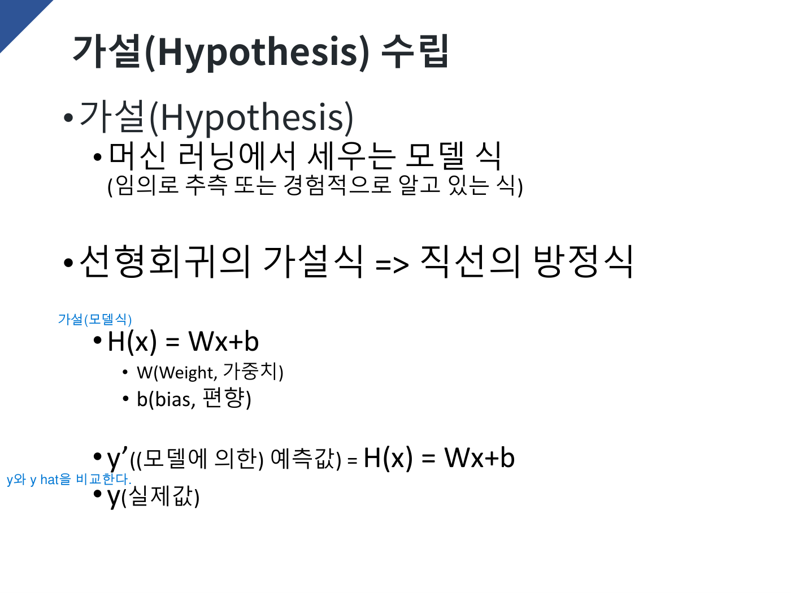
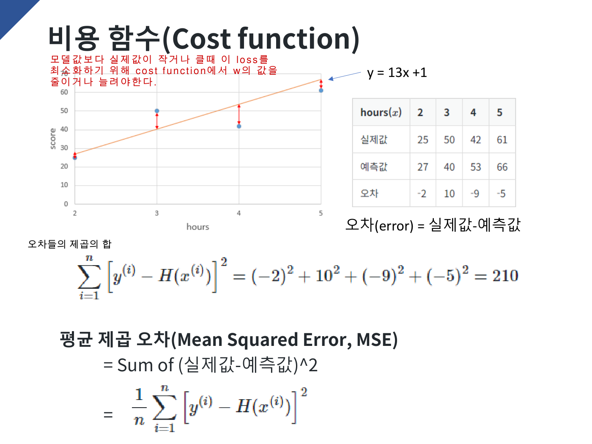
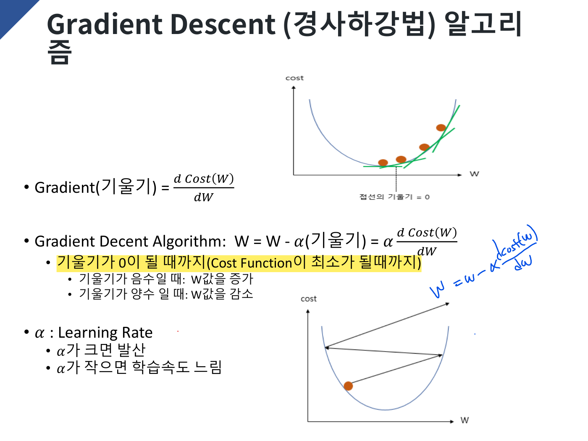
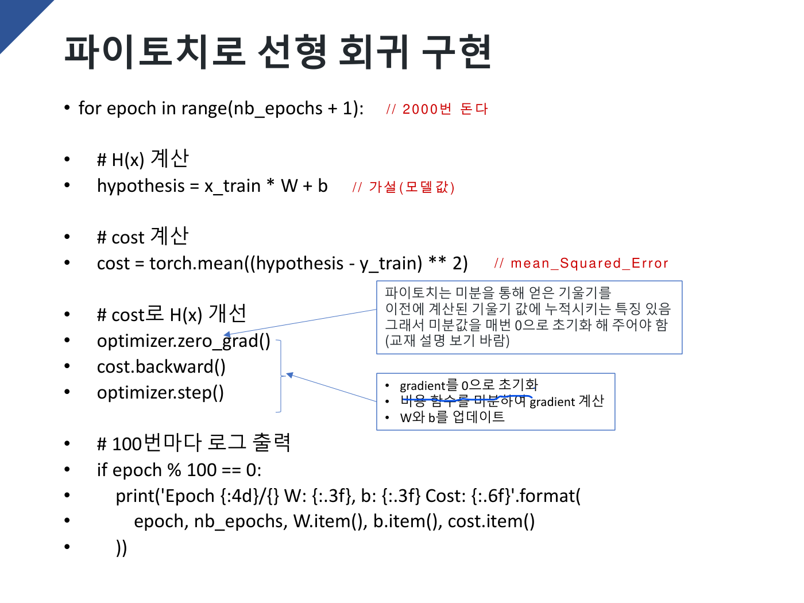

# Simple Linear Regression

원본 [03-01-Simple LR.pdf](https://drive.google.com/file/d/1zkzDYzSeKVRKRU_YIi8yfovlCHXdP_2y/view?usp=drivesdk)

## 1. Hypothesis and Mean Squared Error

원본 9, 14쪽 표기에서 가설은 $H(x)=Wx+b$, Gradient는 $d\,\mathrm{Cost}(W)/dW$, Learning Rate는 $\alpha$다. 아래 유도에서 사용하는 $w, J, \eta$는 각각 원본의 $W, \mathrm{Cost}, \alpha$에 대응한다.
공부 시간 $x$로 점수 $y$를 예측한다. $H(x)=wx+b$에서 기울기 $w$는 한 시간 늘 때 예측 점수의 변화량이고, $b$는 $x=0$에서 모델의 예측이다. 샘플이 $n$개일 때 잔차를 $e_i=wx_i+b-y_i$로 두면

$$
J(w,b)=\frac1n\sum_{i=1}^n e_i^2.
$$

평균은 샘플 수에 따른 합계 크기 차이를 줄이고, 제곱은 양·음 잔차의 상쇄를 막으며 큰 잔차에 더 큰 손실을 준다(7~12쪽).

## 2. Gradient Descent
$\partial e_i/\partial w=x_i$, $\partial e_i/\partial b=1$이다. 제곱의 미분과 곱하면

$$
\frac{\partial J}{\partial w}=\frac2n\sum_i e_ix_i,\qquad
\frac{\partial J}{\partial b}=\frac2n\sum_i e_i.
$$

갱신은 $w\leftarrow w-\eta\,\partial J/\partial w$, $b\leftarrow b-\eta\,\partial J/\partial b$다. 둘 다 갱신 전의 같은 점에서 얻은 기울기를 사용한다. $\eta$는 학습률이다. 기울기가 양수면 해당 변수를 줄이고 음수면 늘린다. 이 MSE는 볼록한 이차식이며 너무 큰 학습률은 진동이나 발산을 일으킬 수 있다(13~14쪽).

## 3. Worked Example
강의의 $(1,2),(2,4),(3,6)$에서 $w=b=0$이면 잔차는 $(-2,-4,-6)$이다.

- $J=(4+16+36)/3=56/3$.
- $\partial J/\partial w=2(-2-8-18)/3=-56/3$.
- $\partial J/\partial b=2(-2-4-6)/3=-8$.
- $\eta=0.01$이면 새 $w=0.1867$, $b=0.08$. 최적해 $w=2,b=0$에 가까워지면 예측 오차가 0에 가까워진다.

## 4. PyTorch Training Loop
```python
import torch

x = torch.tensor([[1.], [2.], [3.]])
y = torch.tensor([[2.], [4.], [6.]])
w = torch.zeros(1, requires_grad=True)
b = torch.zeros(1, requires_grad=True)
optimizer = torch.optim.SGD([w, b], lr=0.01)

for _ in range(2000):
    optimizer.zero_grad()
    prediction = x * w + b
    loss = ((prediction - y) ** 2).mean()
    loss.backward()
    optimizer.step()
```

| 코드 | 수학적 역할 |
|---|---|
| `loss.backward()` | 체인 룰로 $\partial J/\partial w,\partial J/\partial b$를 계산해 `.grad`에 누적 |
| `zero_grad()` | 이전 반복의 누적 기울기 초기화 |
| `step()` | 현재 기울기로 두 파라미터 갱신 |

강의 예제는 매번 세 샘플을 모두 사용한다. 옵티마이저의 이름은 `SGD`이고, 이 코드의 배치 구성은 전체 배치 GD에 해당한다(15~18쪽).

## Original Slides

아래 도판에는 원본의 수식·기호·첨자와 강의 예시를 그대로 담았다. 본문의 유도식과 손계산은 개념을 이해하기 위한 해설이다.

### PDF p. 9



### PDF p. 11



### PDF p. 14



### PDF p. 16


