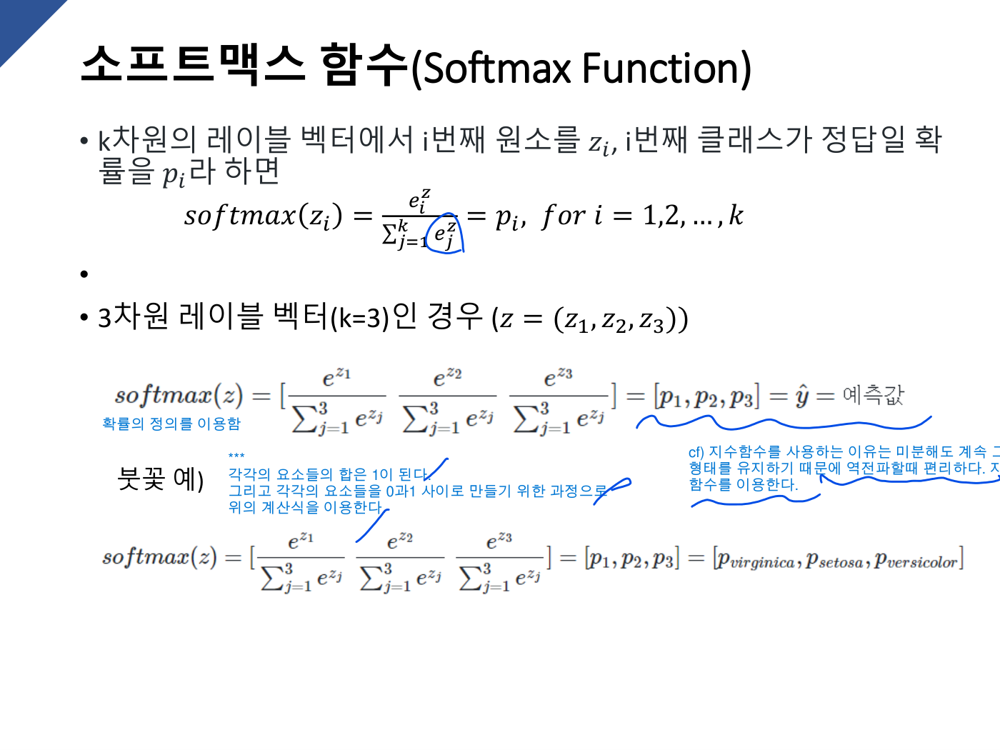
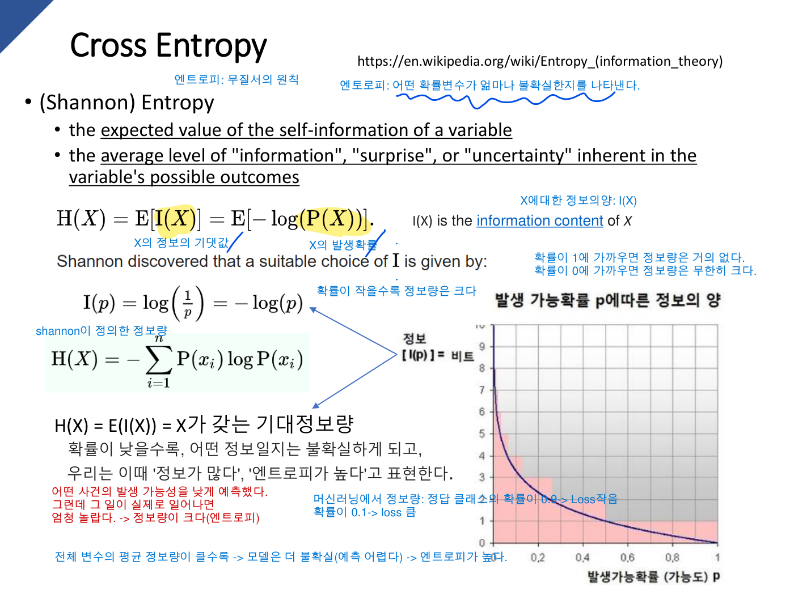
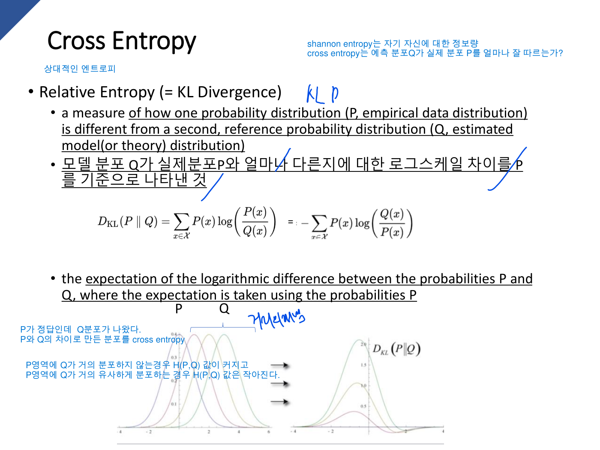
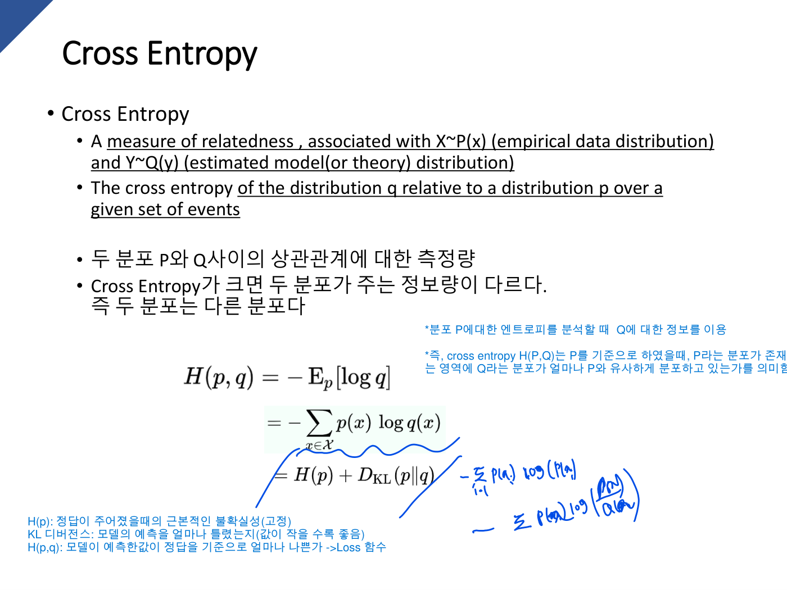
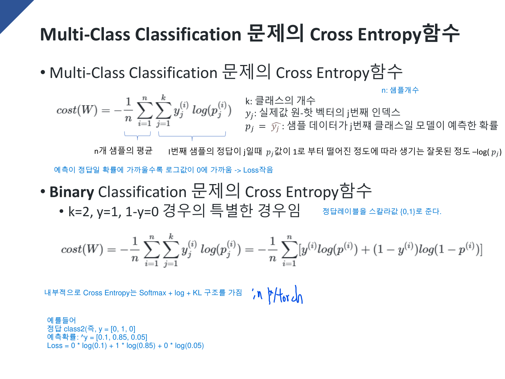
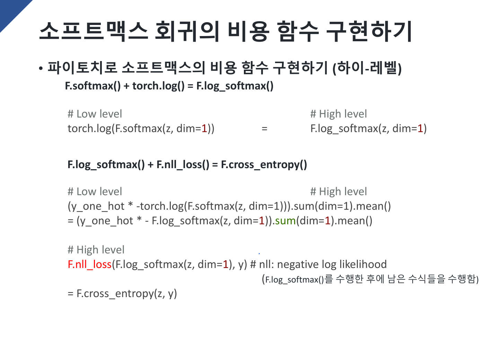

# Softmax Regression

원본 [04-02-Softmax Regression V03.pdf](https://drive.google.com/file/d/1uX7Na9qoBxgi2_MbjSAIhuq-StYaU4kV/view?usp=drivesdk)

## 1. Multiclass Logits and Softmax
상호 배타적인 $K$개 클래스에서 각 샘플을 한 클래스로 분류한다. 입력 $x\in\mathbb R^d$에 대해 $z_k=w_k^\top x+b_k$를 계산한다. $N$개 샘플을 행에 쌓으면 $Z=XW+b$의 크기는 $(N,K)$이고 이때 $W$는 $(d,K)$다. 원-핫 정답 $t$는 정답 클래스 칸만 1인 길이 $K$ 벡터다. 원-핫 표현의 서로 다른 클래스 쌍은 모두 거리 $\sqrt2$이므로 자체적으로 클래스 간 의미의 유사도를 담기 어렵다(2~10쪽).

$$
p_k=\frac{e^{z_k}}{\sum_{j=1}^K e^{z_j}}
=\frac{e^{z_k-m}}{\sum_j e^{z_j-m}},\quad m=\max_j z_j.
$$

지수화로 값이 양수가 되고 합으로 나누면 합이 1인 분포가 된다. 최댓값을 빼면 같은 확률을 얻으며 큰 양수의 지수화로 인한 오버플로를 줄인다. 로짓 $(2,1,0)$의 확률은 약 $(0.6652,0.2447,0.0900)$이다. 로짓과 확률의 순위는 같으므로 클래스 선택에는 로짓의 `argmax`를 써도 된다.

## 2. Entropy, KL Divergence, and Cross Entropy
사건 $k$의 정보량은 $-\log P_k$다. 드문 사건일수록 값이 크다. 자연로그를 사용하면 단위는 nat이다(11~14쪽).

$$
H(P)=-\sum_k P_k\log P_k,\quad
D_{\rm KL}(P\Vert Q)=\sum_k P_k\log\frac{P_k}{Q_k},\quad
H(P,Q)=-\sum_k P_k\log Q_k=H(P)+D_{\rm KL}(P\Vert Q).
$$

$P$가 고정되어 있으면 교차 엔트로피를 줄이는 일은 KL 발산을 줄이는 일과 같다. 원-핫 정답이 인덱스 $c$라면 $H(t,p)=-\log p_c$다. 위 예제에서 정답이 인덱스 1이면 손실은 $-\log 0.2447\approx1.4076$이다.

## 3. Gradient Derivation
$\ell_i=-\sum_k t_{ik}\log p_{ik}=-\sum_k t_{ik}z_{ik}+\log\sum_k e^{z_{ik}}$이다. 두 항의 로짓 미분이 각각 $-t_{ik}$와 $p_{ik}$이므로

$$
\frac{\partial\ell_i}{\partial z_{ik}}=p_{ik}-t_{ik},\qquad
\nabla_W J=\frac1N X^\top(P-T),\qquad
\frac{\partial J}{\partial b_k}=\frac1N\sum_i(p_{ik}-t_{ik}).
$$

확률이 부족한 정답 칸의 로짓 기울기는 음수다. 로짓을 독립적으로 갱신한다면 경사 하강법은 그 점수를 높이는 방향으로 움직인다. 예측 확률과 정답의 합이 모두 1이라서 한 샘플의 로짓 기울기 합은 0이다.

## 4. PyTorch and MNIST
`F.log_softmax(z, dim=1)`는 클래스 축의 로그확률을 계산한다. 그 결과에서 정답 칸을 골라 음수로 바꾸고 평균 내는 것이 `F.nll_loss`다. 두 연산을 합친 `F.cross_entropy(z, y)`의 입력은 원시 로짓 $(N,K)$와 정답 인덱스 $(N,)$인 `torch.long` 텐서다(15~22쪽).

1. MNIST 이미지 배치를 $28\times28$에서 $(B,784)$로 펼친다.
2. `nn.Linear(784,10)`으로 $(B,10)$ 로짓을 계산한다.
3. 교차 엔트로피를 계산하고 `zero_grad`, `backward`, `step`으로 갱신한다.
4. 검증·테스트에서도 학습과 같은 픽셀 전처리를 적용한다. 강의처럼 학습에 `ToTensor()`를 쓴 경우, 테스트도 데이터셋과 로더를 통해 같은 변환을 적용하면 값의 범위가 일치한다.
5. 예측은 `logits.argmax(dim=1)`, 정확도는 정답과 일치한 샘플의 비율이다. 강의의 MNIST 예제는 배치 100, 15 epoch, SGD 학습률 0.1을 쓴다(23~29쪽).

## Original Slides

아래 도판에는 원본의 수식·기호·첨자와 강의 예시를 그대로 담았다. 본문의 유도식과 손계산은 개념을 이해하기 위한 해설이다.

### PDF p. 7

### PDF p. 11

### PDF p. 12

### PDF p. 13

### PDF p. 14

### PDF p. 17

