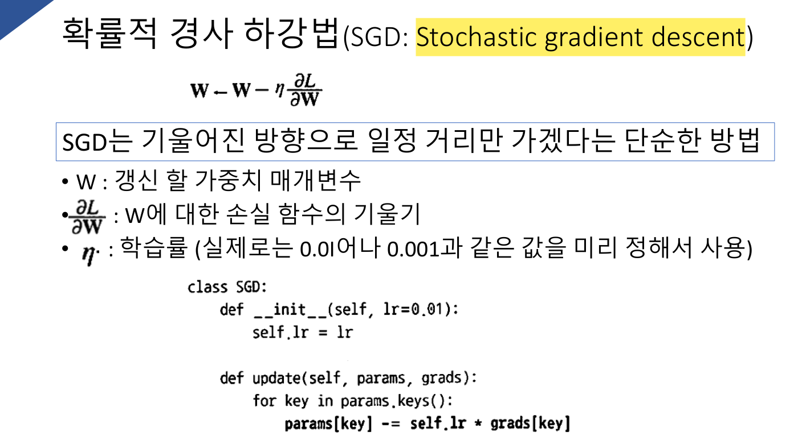
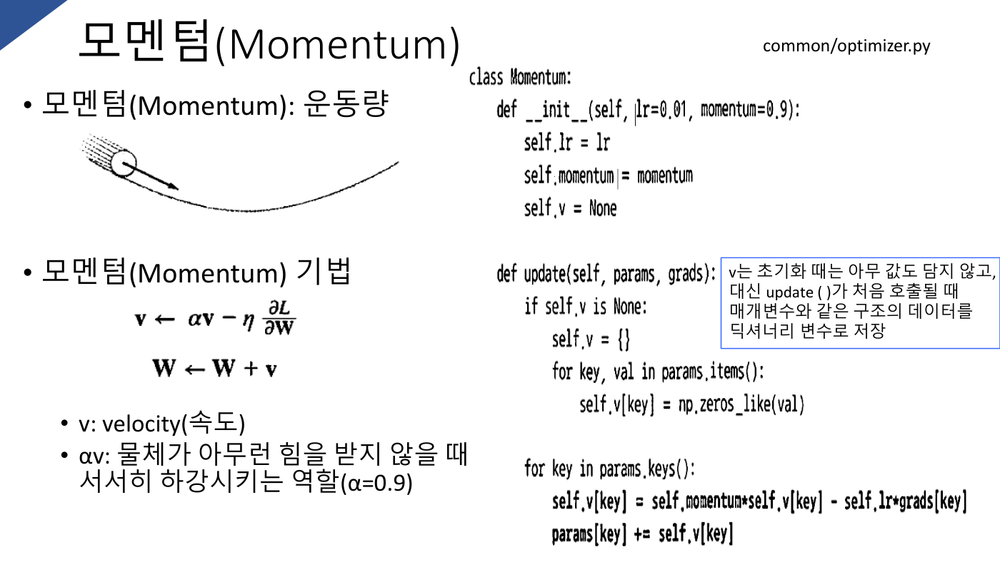
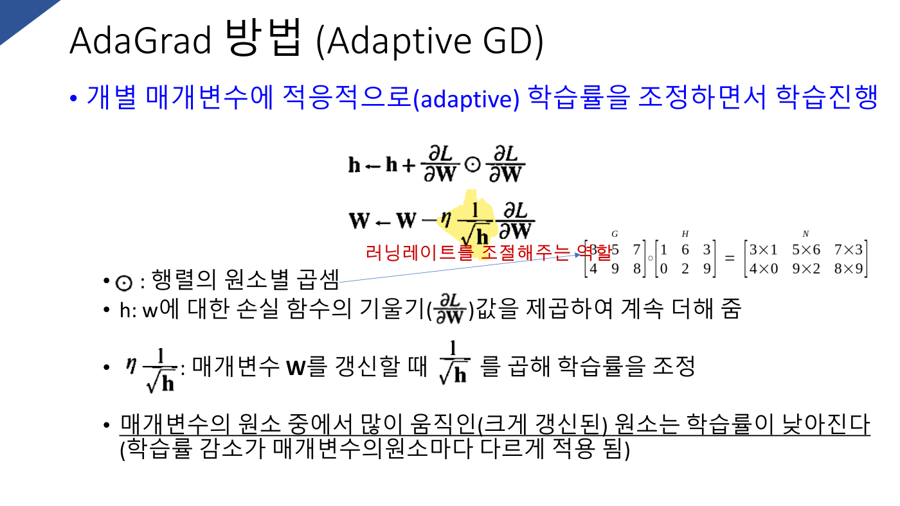
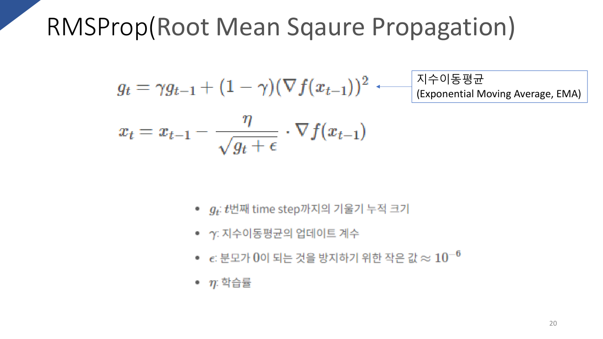
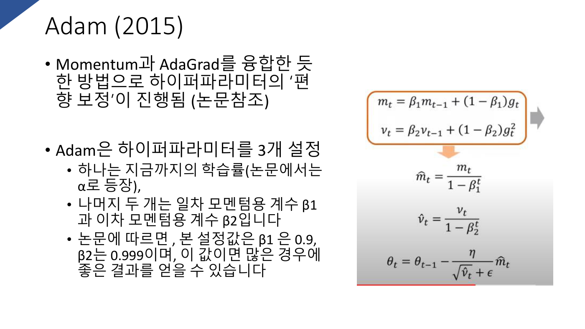
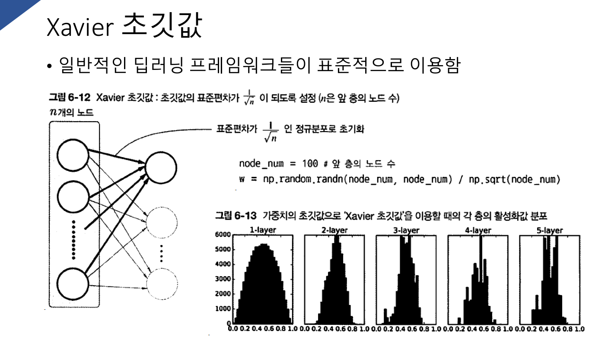
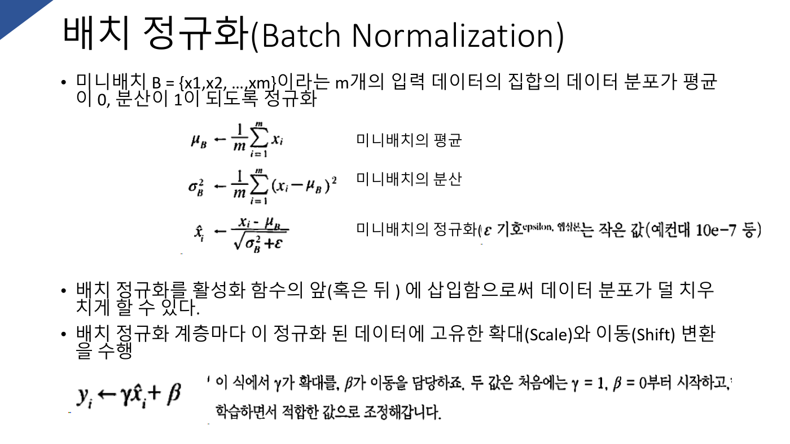

# Training Techniques

원본 [06-02-기타 학습기법들 V02-Adagrad 추가.pdf](https://drive.google.com/file/d/1BkdQGMl-vTmkcnDS9e4VP4X0qqLtu-ME/view?usp=drivesdk)

## 1. SGD, Momentum, AdaGrad, RMSProp, and Adam

원본 도판은 SGD·Momentum·AdaGrad에서 업데이트 대상 가중치를 $W$, Momentum의 감쇠를 $\alpha$, AdaGrad의 제곱 기울기 누적값을 $h$로 표기한다. 아래 비교표에서는 여러 방법을 같은 기준으로 비교할 수 있게 각각 $\theta,\mu,s_t$로 쓴다.
$\theta_t$는 모델 파라미터, $g_t=\nabla_\theta J_{\rm batch}(\theta_{t-1})$, $\eta$는 기본 학습률이다. 제곱·제곱근·나눗셈은 원소별 연산이다. 옵티마이저는 기울기를 입력 받아 갱신량을 정한다(3~24쪽).

| 기법 | 상태와 갱신 | 동작 |
|---|---|---|
| SGD | $\theta_t=\theta_{t-1}-\eta g_t$ | 현재 미니배치 기울기를 바로 사용한다. 곡률이 축마다 다르면 가파른 방향에서 지그재그로 움직일 수 있다. |
| Momentum | $v_t=\mu v_{t-1}-\eta g_t$, $\theta_t=\theta_{t-1}+v_t$ | 같은 방향으로 반복되는 기울기는 누적되고 번갈아 바뀌는 방향은 상쇄된다. |
| AdaGrad | $s_t=s_{t-1}+g_t^2$, $\theta_t=\theta_{t-1}-\eta g_t/(\sqrt{s_t}+\epsilon)$ | 제곱 기울기가 많이 누적된 좌표의 유효 학습률을 줄인다. 누적값은 감소하지 않는다. |
| RMSProp | $s_t=\rho s_{t-1}+(1-\rho)g_t^2$, $\theta_t=\theta_{t-1}-\eta g_t/(\sqrt{s_t}+\epsilon)$ | 제곱 기울기의 지수이동평균을 사용해 오래된 기울기의 영향을 줄인다. |
| Adam | $m_t=\beta_1m_{t-1}+(1-\beta_1)g_t$, $v_t=\beta_2v_{t-1}+(1-\beta_2)g_t^2$ | 기울기의 1차 모멘트와 제곱 기울기의 2차 원시 모멘트를 함께 사용한다. |

Adam은 $m_0=v_0=0$으로 시작한다. 그 때문에 초기 추정치가 0 쪽으로 치우치는 현상을 보정한다.

$$
\hat m_t=\frac{m_t}{1-\beta_1^t},\quad
\hat v_t=\frac{v_t}{1-\beta_2^t},\quad
\theta_t=\theta_{t-1}-\eta\frac{\hat m_t}{\sqrt{\hat v_t}+\epsilon}.
$$

**손계산**. 학습률 0.1, 연속 기울기 2와 2에서 AdaGrad 상태는 4와 8이다. 두 번의 이동량 크기는 약 0.1과 0.0707이다. 같은 조건에서 Momentum의 $\mu=0.9$라면 속도는 $-0.2,-0.38$이다. Adam 첫 스텝은 $\hat m_1=2,\hat v_1=4$가 되어 $\epsilon$을 무시하면 이동량은 $-0.1$이다. 전역 학습률 스케줄은 $\eta$ 자체를 바꾸고 AdaGrad 등은 좌표별 분모를 바꾼다.

## 2. Weight Initialization
모든 은닉 뉴런을 같은 값으로 초기화하면 같은 입력과 경로에서 같은 갱신을 받아 서로 다른 특징을 학습하기 어렵다. 시그모이드는 입력 절댓값이 너무 크면 포화되어 도함수가 작고, 너무 작은 가중치만 계속 곱하면 활성값 변화가 줄어든다(26~36쪽).

선형 결합 $z=\sum_{j=1}^{n}w_jx_j$에서 항들의 독립성과 영평균 가중치를 가정하면 $\mathrm{Var}(z)\approx n\,\mathrm{Var}(w)\,\mathbb E[x^2]$다. 따라서 대략 $1/n$의 분산이 스케일을 유지한다. 슬라이드의 fan-in 기반 Xavier 설명에서는 표준편차 $1/\sqrt{n_{\rm in}}$를 사용한다. 보충으로 Glorot/Xavier normal의 흔한 정의는 $\sqrt{2/(n_{\rm in}+n_{\rm out})}$다. ReLU는 대칭 분포 입력의 음수 절반을 0으로 만들어 출력의 제곱평균을 절반 정도 줄이므로 He 초기화는 $\sqrt{2/n_{\rm in}}$의 표준편차를 쓴다. $n_{\rm in}=100$이라면 fan-in 방식의 두 표준편차는 0.1과 약 0.1414다.

## 3. Batch Normalization
한 특징의 미니배치 값 $x_1,\dots,x_B$에 대해

$$
\mu_B=\frac1B\sum_i x_i,\quad
v_B=\frac1B\sum_i(x_i-\mu_B)^2,\quad
\hat x_i=\frac{x_i-\mu_B}{\sqrt{v_B+\epsilon}},\quad
y_i=\gamma\hat x_i+\beta.
$$

$\gamma,\beta$는 특징별로 학습하는 스케일과 이동값이다. $(1,3)$이면 평균 2, 분산 1, 정규화 결과는 $\epsilon$을 무시하면 $(-1,1)$이다. $\gamma=2,\beta=0.5$이면 출력은 $(-1.5,2.5)$다. 학습 중에는 미니배치 통계를 쓰고, 일반적인 추론 설정에서는 학습 중 누적된 통계를 고정해 쓴다. $\epsilon$은 분산이 작을 때 0으로 나누는 문제를 막는다. 강의는 활성값 분포와 학습 속도, 초기화에 대한 민감도 변화를 비교한다(37~43쪽).

## 4. Hyperparameter Optimization
가중치와 편향은 기울기로 학습한다. 학습률, 배치 크기, epoch 수, 규제 강도는 검증 성능을 보고 선택한다(44~56쪽).

1. 훈련/검증을 분리하거나 $K$-fold로 나눈다. $K$-fold에서는 각 fold를 한 번씩 검증에 사용하고 평균 검증 성능을 비교한다.
2. 강의 예시처럼 학습률 $10^{-6}\sim10^{-2}$와 감쇠 강도 $10^{-8}\sim10^{-4}$ 같은 범위를 정한다. 로그 균등 샘플링은 예를 들어 $u\sim U(-6,-2)$ 후 $\eta=10^u$로 정한다.
3. Grid search는 후보 조합을 모두, random search는 범위에서 뽑은 조합을 평가한다. Bayesian optimization은 이미 얻은 점수로 다음 후보를 고를 때 사용할 대리 모형을 갱신한다.
4. 적은 epoch로 후보를 빠르게 비교하고, 성능이 좋은 범위에서 더 촘촘하게 탐색하거나 길게 학습해 후보를 검증한다. 최종 설정을 정한 뒤 테스트 성능을 측정한다.

## Original Slides

아래 도판에는 원본의 수식·기호·첨자와 강의 예시를 그대로 담았다. 본문의 유도식과 손계산은 개념을 이해하기 위한 해설이다.

### PDF p. 5

### PDF p. 11

### PDF p. 15

### PDF p. 20

### PDF p. 22

### PDF p. 32

### PDF p. 34

### PDF p. 39

